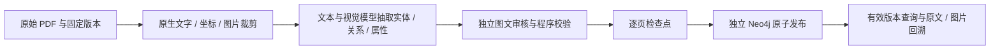

# DJI / Parrot 文档图谱独立批次验证

文档实体与关系抽取、多模态证据审核、Neo4j 入库、失败恢复和查询已在新建文档实例运行。批次沿用人工复核 golden 对应的两本原始手册，处理 13 个代表页，覆盖部件图、技术参数、安装操作和 LED 状态表。本轮范围是选定页，未将未处理的章节计为完成。

## 实例与连接

| 项目 | 配置 |
|---|---|
| Compose | `docker-compose.document-graph.yml`，独立项目 `rag-document-graph` |
| 容器 | `intelligence-rag-neo4j-document` |
| Neo4j Browser | <http://127.0.0.1:7476> |
| Bolt | `bolt://localhost:7689` |
| 数据卷 | `rag-document-graph_neo4j-document-data` |
| 日志卷 | `rag-document-graph_neo4j-document-logs` |
| 私有连接配置 | 项目根目录 `.env.document-graph`，权限 0600，未纳入 Git |
| 独立只读 API | <http://127.0.0.1:8001/docs>，入口 `app.document_graph_main:app` |

文档存储强制读取 `DOCUMENT_GRAPH_NEO4J_URI/USER/PASSWORD/DATABASE`。缺少 URI 或密码会在连接前报错，不能继承视频实例的 `NEO4J_*`。CLI 使用 `--env-file .env.document-graph`，文本及视觉模型仍复用项目 `.env` 配置。没有更改现有视频服务的启动配置。

原视频库的节点、边、全部属性和卷配置在文档构建前后完全一致。`video-next` 库存在一个早于本任务启动的后台视频构建进程（PID 186930），核验期间节点从 10246 增至 10541、边从 12960 增至 13324，不能宣称其全库快照不变。两座视频库均为零个 `DG*` 节点；三个实例的容器和数据库 ID 不同，文档卷与视频卷的集合交集为空。连接隔离与并发变化记录见 [隔离验证](../data/document_graph_runs/isolated-20261111/isolation-audit.json)、[视频库前快照](../data/document_graph_runs/isolated-20261111/video-before.json)、[后快照](../data/document_graph_runs/isolated-20261111/video-after.json)。

## 实际入库结果

| 手册 | PDF 物理页 | 实体 | 实体间关系 | 参数 / 状态 / 操作事实 | 全部事实 |
|---|---|---:|---:|---:|---:|
| DJI Air 2S 中文用户手册 v1.0 | 9、26、28、50–53 | 33 | 29 | 74 | 103 |
| Parrot ANAFI Ai 英文用户指南 v7.7.1.7 | 14、15、17–19、23 | 25 | 25 | 51 | 76 |
| 合计 | 13 页 | 58 | 54 | 125 | 179 |

“实体间关系”按存在实体客体统计；全部事实还包括 `has_parameter`、`indicates`、`instruction` 等。参数值保存为事实的值，不把所有数字创建为实体。图中有 74 条实体提及、179 条事实证据、28 个图片区域；HTTP 返回的事实实际引用 15 个不同图片资源。Parrot 第 15 页此次没有通过审核的事实，保留该页来源与零事实结果，未补写输出。

完整实体与事实见 [全量人工复核表](../data/document_graph_runs/isolated-20261111/graph-review.html)，包含实体类型、作用域、事实完整字段、原文、页码和原图；[机器回读报告](../data/document_graph_runs/isolated-20261111/graph-review.json)保留实际 Neo4j 输出与检查项。

## 已验证的闭环



| 检查 | 结果与证据 |
|---|---|
| 原始材料重建 | 重新从两本原始 PDF 准备 13 页，固定哈希和版本；[prepare.log](../data/document_graph_runs/isolated-20261111/prepare.log) |
| 模型结果与审核 | 重新生成当前代码版本的抽取 / 审核凭据；精确重放已有真实模型响应，没有使用测试夹具替代；[抽取结果](../data/document_graph_runs/isolated-20261111/extraction.json) |
| 检查点恢复 | DJI 首个真实页面存检查点后注入中断；重试后 attempts=2，该页结果保持一致，两本手册成功入库；[恢复与生命周期审计](../data/document_graph_runs/isolated-20261111/lifecycle-audit.json) |
| 图谱独立回读 | 两本手册的实体、提及、事实、端点、证据边、页、行、图片区域和审核绑定均与有效输出匹配；[构建报告](../data/document_graph_runs/isolated-20261111/build.json) |
| HTTP 全量检索 | 查询覆盖全部 179 条事实，15 个引用图片的实际内容 SHA-256 与 ETag 均一致；[HTTP 检查](../data/document_graph_runs/isolated-20261111/graph-review.log) |
| 幂等运行 | 再次运行均为 `already_current`，无模型请求；[重复构建](../data/document_graph_runs/isolated-20261111/repeat-build.json) |
| 撤回与恢复 | 撤回时事实不可检索、图片返回 404，恢复后图片返回 200，最终两本手册校验通过；[生命周期审计](../data/document_graph_runs/isolated-20261111/lifecycle-audit.json) |
| 实例重启持久性 | 重启文档容器后，全部节点计数和有效构建 ID 一致，179 条事实及引用图片再次通过 HTTP 校验；[持久化审计](../data/document_graph_runs/isolated-20261111/persistence-audit.json) |
| 视频隔离 | 原视频库快照不变；next 库存在并发视频构建。连接、数据库 ID 和数据卷独立，两座视频库均无文档节点；[隔离审计](../data/document_graph_runs/isolated-20261111/isolation-audit.json) |

本轮正例及负例共重放 60 个精确模型请求，恢复入库重放其中 45 个请求，新增模型 HTTP 调用为 0。历史响应的 provider usage 保留为历史使用量，不计作本轮新调用。缓存位于本批次的 `responses/`，来源包位于本批次的 `source/`，构建可直接继续使用该目录。

## Golden 与测试

人工复核完成的 v1 golden：19/19 目标事实、13/13 图文关联目标、4/4 错配负例通过。见 [逐条对照表](../data/document_graph_runs/isolated-20261111/comparison.html)和[指标 JSON](../data/document_graph_runs/isolated-20261111/comparison.json)。这是固定目标的验证，不是全部 179 条事实的精确率，也不代表实体或关系的整体 F1。

- 文档单元及 Compose 配置检查：52 项通过。
- 文档 Neo4j 生命周期与篡改检测：16 项通过。
- 视频 Neo4j 存储回归：13 项通过、1 项跳过。
- 视频 / 文档图谱相关单元回归：344 项通过、18 项跳过、4 项未选中。

Neo4j 集成测试只在 `127.0.0.1:45969` 的临时空库运行，未将会清库的测试指向正式文档或视频实例。测试结束后删除临时容器；文档正式实例保留运行。日志在 [本批次目录](../data/document_graph_runs/isolated-20261111/)。

## 继续运行与查看

```bash
# 持久化文档实例；此命令不涉及视频实例。
docker compose --env-file .env.document-graph -f docker-compose.document-graph.yml up -d

# 对已有批次幂等构建；缓存缺失时拒绝调用模型。
uv run python tools/document-knowledge-graph/build_graph.py --env-file .env.document-graph pipeline \
  --source-bundle data/document_graph_runs/isolated-20261111/source \
  --report data/document_graph_runs/isolated-20261111/build.json \
  --response-cache data/document_graph_runs/isolated-20261111/responses --cache-only

# 独立启动只读 HTTP API，供查事实和查看原图。
uv run uvicorn app.document_graph_main:app --app-dir backend \
  --env-file .env.document-graph --host 127.0.0.1 --port 8001

# 校验全部图谱事实与 HTTP 图片，并输出人工复核表。
uv run python tools/document-knowledge-graph/verify_batch.py \
  --env-file .env.document-graph \
  --source-bundle data/document_graph_runs/isolated-20261111/source \
  --output data/document_graph_runs/isolated-20261111/graph-review.json \
  --api-url http://127.0.0.1:8001
```

Browser 中可执行以下只读查询查看有效构建的关系。参数、操作和灯态均以事实节点显示：

```cypher
MATCH (m:DGManual)-[:HAS_BUILD]->(b:DGBuild)-[:HAS_CASE]->(:DGCase)-[:HAS_FACT]->(f:DGFact)
WHERE m.active_build_id = b.id AND NOT m.withdrawn
MATCH (f)-[r:SUBJECT|OBJECT]->(e:VGEntity)
RETURN m, b, f, r, e LIMIT 300;
```

新增文档仍需在选择清单固定文件哈希、版本、页码和页面类别。当前覆盖原生文字 PDF 和已支持的四类页面；整本手册自动章节识别、扫描文档 OCR、复杂跨页表格以及视频 / 文档联合检索尚需后续扩展。
