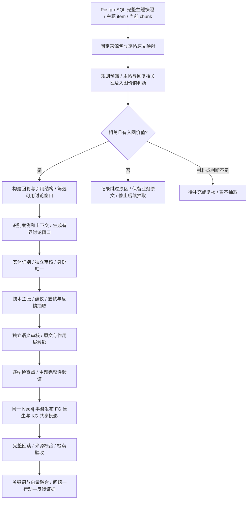

# 论坛知识图谱构建管线设计

日期：2026-11-11。状态：设计稿，未实现管线或脚本，未运行模型、写入图谱、修改数据库或定时任务。

建议采用“前置价值判断、主题级发布、回复级抽取、案例级验证”：继续使用一个论坛主题一个 `content_items`，先独立判断主帖及回复是否与无人机技术相关、是否有可利用的入图信息，通过后再构建讨论语义并抽取实体/关系，通过现有共享发布协议接入视频、文档统一图谱。

论坛的主要价值是具体设备、固件和配置下的问题及处理过程。不能把提问、建议、推测、获采纳或时间上的先后关系直接提升为普遍成立的技术事实。

## 1. 当前基础与复用边界

以下“已有”指当前工作区代码能力，不代表所有运行服务均已部署此版本。本设计不沿用 2026-10-22 的入库数量作为当前统计。

| 环节 | 已有能力 | 论坛设计 |
| --- | --- | --- |
| 业务来源 | PostgreSQL 保存原始快照、item、chunk | 直接读取完整主题快照、`metadata_json.posts` 和当前 chunk，不重新抓取 |
| 视频前置判断 | `assess` 在实体抽取前判断材料相关性，保存 relevant/reason | 沿用独立 assessment 阶段，新增入图价值判断，两项通过才抽取 |
| 视频抽取 | 实体抽取/审核、身份归一、关系分类/独立审核、原文定位 | 复用审核与落地原则，增加回复关系、发言行为、场景及反馈判定 |
| 文档抽取 | 固定来源包、原生文字/图片定位、窗口检查点、参数/操作事实 | 复用来源包、逐窗口处理和结构化事实设计；一期先做文本 |
| 原生图谱 | 视频 `VG*`、文档 `DG*`，各自管理任务及来源证据 | 建议新增 `FG*`，保存论坛讨论、构建、主张与反馈 |
| 共享图谱 | `Publication / Entity / Fact / Evidence`，`KG*` 共享投影 | 新增论坛适配器；来源类型为 `forum`，不另建一套全局实体体系 |
| 发布生命周期 | Neo4j 租约、检查点、有效构建指针、原子发布、撤回 | 按主题领取与发布；抽取结果按回复/窗口保存，失败可续跑 |
| 问答 | 关键词/向量检索；视频图谱召回后回源校验 | 增加论坛回源适配、案例与反馈召回，保留具体回复引用 |

当前共享 `Publication.source_type` 已允许扩展字符串，`Fact` 支持 `relation / attribute / state / instruction`，`Evidence.locator` 支持来源扩展字段。论坛可以接入该协议，但现有协议没有完整的讨论主张、反馈目标和案例模型，需要论坛原生层及检索适配补齐。

当前 `graph_retrieval.py`、`answer_graph.py` 仍直接使用视频请求/响应及视频来源校验。将论坛写入 `KG*` 并不等于聊天自动支持论坛图谱；统一查询、论坛证据回源及回答呈现必须独立验收。

参考代码与文档：

- [视频图谱架构](knowledge-graph.md)、[抽取与审核规则](knowledge-graph-extraction.md)。
- [文档图谱](document-knowledge-graph.md)、[统一知识图谱](unified-knowledge-graph.md)。
- [共享发布协议](../backend/app/services/knowledge_graph/schema.py)、[共享事务发布](../backend/app/services/knowledge_graph/storage.py)。
- [论坛逐帖状态与来源](../tools/forum-crawler/scripts/discourse_topics.py)、[论坛加工逻辑](../tools/forum-crawler/scripts/discourse_process.py)。

## 2. 总体流程

采集、文本加工、向量化、图谱构建保持独立。构图不要求 chunk 已完成向量化，也不改变现有采集游标。图谱失败不回滚已归档正文，不影响后续论坛采集。

## 3. 来源包与处理单位

### 3.1 来源身份

- 业务身份继续使用规范论坛地址与 `topic_id`，保留现有主题 item ID。
- 共享来源：`source_type=forum`，`external_id` 使用规范化站点身份与 `topic_id` 的组合，避免 ArduPilot 与 PX4 的数字 ID 碰撞。
- 一次构建固定完整快照、逐帖版本及可见性、标题、回复关系、采纳状态、当前 chunk 映射和规则版本。
- 仅处理完整快照，且最新待加工快照与主题 item 的来源绑定一致。若采集已更新但文本加工未完成，先等待加工完成。

### 3.2 逐帖读取，不能只依赖 item 拼接正文

图谱来源读取器同时使用：

1. `raw_pages` 的完整主题快照：原始主帖、回复、引用、代码和附件引用。
2. `metadata_json.posts`：逐帖正文、作者、版本、可见性与现有处理状态。
3. 当前 `content_chunks`：有效检索文本与 chunk ID、楼层及逐帖区间映射。

原始发言、引用他人内容、代码/日志片段、生成的标题/作者前缀和检索上下文必须区分。`embed_text` 中附加的原问题与父回复不能作为当前作者的新发言，也不能作为独立佐证。

建立不可变的逐帖文本视图与原文映射：所有引文保留 `post_id + 帖子版本/正文哈希 + 帖内偏移`。Markdown、HTML 展开及块分割需要可回溯的映射；无法可靠对齐的引文拒绝发布，不用模型改写替代原文。

### 3.3 三个处理单位

| 单位 | 用途 |
| --- | --- |
| 主题 | 来源身份、任务领取、完整性检查和原子发布 |
| 回复/讨论窗口 | 模型抽取、审核、检查点和增量复用 |
| 案例 | 绑定设备、固件、配置、现象、操作与结果，隔离同帖不同用户的问题 |

一个主题可以包含多个案例。其他用户的“我也遇到了”不能自动继承楼主的设备、固件或配置。无法确定案例归属时保留未知，不强行合并。

## 4. 论坛原生图谱与共享图谱

### 4.1 原生层建议

| 节点 | 作用 |
| --- | --- |
| `FGTopic` | 主题身份、item 引用、目标与有效构建、撤回状态 |
| `FGBuild` | 来源/规则指纹、租约、检查点、审核结果、使用量与完成状态 |
| `FGPost` | 绑定构建的不可变发言版本、楼层、作者、时间、回复对象及来源哈希 |
| `FGSpan` | 原文片段、块类型、帖内偏移、快照及 chunk 映射 |
| `FGCase` | 一个具体排障/配置场景及其上下文证据，不表示同类问题的通用答案 |
| `FGClaim` | 有明确发言主体和场景的观察、假设、建议或技术陈述 |
| `FGEvaluation` | 某次尝试/反馈针对哪条建议或操作组合、结果及证据 |

主要关系包括 `HAS_BUILD / HAS_POST / REPLIES_TO / QUOTES / IN_CASE / STATES / EVALUATES`。原文缺少明确回复对象时，不因相邻楼层就构造显式 `REPLIES_TO`；向主题根部的归属与直接回复关系分开保存。引用关系能确定原帖时保存来源，不能确定时保留引用文本和未知目标。

作者作为带论坛作用域的来源属性保存，不默认把所有用户名作为业务知识实体。

原生主张、反馈及实体引用都必须经当前有效构建过滤。更换主题构建不能使历史回复或历史验证结果继续影响当前答案。

### 4.2 业务实体与身份

一期沿用已有实体类型中的设备、部件、软件、协议、技术、方法和故障，例如 `product / component / software / protocol / technology / method / fault`。

- 明确具名的 PX4、ArduPilot、MAVLink 和硬件型号可使用已审核全局身份；兼容现有全局 ID 规则，避免同名重复造节点。
- “我的飞控”“这个 GPS”“这台飞机”等默认限定在具体案例，不作为全局实体或全局别名。
- 部件按有证据的设备所有者限定；同名传感器不自动跨机型归并。
- 固件、硬件修订和运行环境主要作为事实条件/案例上下文，不为每个数字版本都新增一个实体。
- 一期参数名与参数值采用属性/操作事实，与文档图谱一致；数值和单位不单独建实体。相同参数名必须绑定软件栈及已知版本范围。
- 设备全局身份可以共享，用户自己的具体设备及“发生了某故障”的案例仍保留局部作用域。

现有视频身份逻辑包含 `video` 专属作用域，不能直接把论坛当视频调用。应复用规范化原则和全局身份兼容规则，新增明确的论坛主题/案例作用域，并单独验证。

### 4.3 必须分开的语义维度

| 维度 | 示例 | 含义 |
| --- | --- | --- |
| 发言行为 | question、observation、hypothesis、recommendation、test_report、correction | 当前作者在做什么；同一回复可有多种行为 |
| 断言 | asserted、uncertain、negated | 来源如何陈述某个命题，与现有 KG 协议一致 |
| 案例反馈 | unknown、reported_success、reported_failure、mixed | 本案例某次尝试的结果，不是全局技术真假 |
| 验证信号 | 作者反馈、其他案例复现、实际日志支持、人工复核 | 带来源的独立记录，可以并存，不压成单一模型分数 |
| 社区状态 | accepted_answer、点赞等 | 排序与社区上下文；不自动证明建议正确 |

提问不生成肯定技术事实。`asserted` 仅代表来源明确陈述；作者说“问题解决了”最多证明其报告了成功，不能自动变成因果证明或跨设备保证。

现有 `post_role=verification` 属于文本启发式结果，只作为候选信号；需要重新识别具体行动、反馈对象、作者和场景后才能建立 `FGEvaluation`。

### 4.4 映射到共享协议

一期尽量复用现有谓词与四类事实：

| 来源信息 | 表示方式 | 限制 |
| --- | --- | --- |
| 设备连接、支持、兼容等明确描述 | relation，复用 connected_to / supports / compatible_with 等 | 必须有明确端点及引文，不能根据共现建边 |
| 某设备在本案例出现故障 | reports_fault，附案例/版本条件 | 不等于该型号普遍存在此故障 |
| 实际配置或测量值 | attribute，has_parameter | 区分实际值、默认值、建议值、旧值与新值 |
| 设置步骤或排障操作 | instruction，结构化保存操作及参数 | 建议与已执行步骤分开，不写成设备默认属性 |
| 某操作缓解问题 | mitigates，附案例范围与反馈证据 | 只有来源明确支持时发布；不能由时间先后推导 |
| 猜测原因、未经验证的建议 | 先存 FGClaim；可按明确类型输出假设或建议 | 默认排障事实召回不将其作为已验证方案 |

论坛适配器输出 `Publication(source_type=forum)`。实体进入 `KGEntity`，可发布的技术陈述进入 `KGFact`，对应原文进入 `KGEvidence`；其余讨论过程保存在 `FG*` 中。

**语义条件与来源评价分开存储：**

- 软件、版本、硬件、运行模式和案例适用范围属于事实语义，进入 `qualifiers/details`；案例限定必须参加事实身份，防止与通用文档事实错误合并。
- 作者、楼层、采纳、反馈目标和验证信号属于来源评价，进入原生主张/反馈及证据定位，不因不同发言者就制造不同通用事实 ID。
- 原生 `FGClaim` 标识自身案例和命题；在映射为共享事实时写入其实际语义范围。不能只把范围藏在引文中，却发布一个无条件的全局事实。
- 肯定、否定、不同数值或条件继续沿用现有 KG 的不同事实 ID；相同命题的独立证据可以聚合，但引用同一原帖的转述不算独立验证。

共享事实身份不做同义语义猜合并。跨来源只复用已确认的实体与语义一致事实，不因同名或相似句子自动建立等价关系。

## 5. 抽取、审核与来源校验

### 5.1 抽取前必经的相关性与入图价值判断

参考视频 `assess → relevant → extract` 的顺序，在实体、关系及案例语义抽取前设置独立 `assessment`。当前视频实现主要返回 `relevant/reason`；论坛设计增加独立的入图价值判断，不能把“提到了无人机”视为自动通过。

两个必要条件分别为：

1. **技术相关性**：正文是否涉及无人机及其设备、部件、软件/固件、协议、配置、飞行控制、维护、故障或开发工作流。
2. **入图价值**：当前可读取原文是否包含具体、可定位、可以组织为技术知识或案例证据的信息。

仅两项均通过，才允许进入后续实体/关系抽取与图谱构建。分类、关键词、标题、回复数量、点赞及采纳状态只能辅助判断，不能代替正文依据。

#### 5.1.1 判断顺序与输入

先进行低成本规则预筛，过滤确定的广告、交易、招聘、站务、空白及纯重复占位；其余候选交给一次独立的轻量语义判断。混合内容或规则无法确定的材料不能被简单关键词规则直接淘汰。

主题级输入包括标题、分类、主帖、回复正文及必要的回复/引用标记，明确区分原始发言和引用。读取回复十分必要：主帖可能很简略，但后续回复包含完整解释或排障结果。前置判断本身不生成实体、关系或案例结论，只给出是否值得进入后续流程及原文依据。

长帖按有界文本窗口判断并聚合，保存已覆盖帖子/窗口与未覆盖范围。不得仅截取前几千字便把整帖判为无价值；判定整帖跳过前必须覆盖全部当前可用候选窗口。某窗口发现明确价值后可以使主题通过，但后续仍需判断其他窗口的处理角色与覆盖状态。

#### 5.1.2 入图价值标准

| 内容 | 默认决定 | 原因与边界 |
| --- | --- | --- |
| 设备/软件与具体症状、错误信息、复现条件 | 可进入抽取 | 未解决也可能形成有价值的问题案例，不要求必须有答案 |
| 参数配置、操作步骤、代码用法、协议机制、技术解释 | 可进入抽取 | 必须有具体内容及可定位原文；仅贴文件名或链接不算已读材料 |
| 版本差异、设备兼容/连接、明确限制 | 可进入抽取 | 保留所述条件，后续仍需实体身份与关系审核 |
| 明确对应建议的成功、失败或纠正反馈 | 可进入抽取或更新案例 | 短回复也可能重要，应结合父回复/引用判断其新增价值 |
| 简短提问“怎么用”“不能飞了怎么办”，无可用背景 | 跳过或待补充 | 仅涉及无人机，但缺乏当前可利用的信息 |
| 无技术信息的价格讨论、闲聊、泛泛评价、纯感谢、顶帖 | 跳过 | 不产生可利用的技术知识；混有具体技术内容时另行判断 |
| 重复粘贴/引用且没有新增解释或验证 | 跳过独立抽取，必要时仅作上下文 | 避免重复计事实或独立佐证 |
| 只有图片/飞行日志附件而尚未解析 | 待材料 | 保留来源，不能猜测附件内容，也不永久判为无价值 |

“入图价值”不要求模型在前置阶段已经证明某条关系成立。它判断是否存在值得处理的信息；真实关系、断言、案例归属和结论可信度仍由后续抽取与独立审核决定。

#### 5.1.3 判断结果与流程分支

建议 assessment 保存以下结构化信息，作为处理状态与审计记录，不作为业务知识事实：

| 字段 | 含义 |
| --- | --- |
| `uav_technical_related` | 是否与无人机技术相关；证据不足可为空 |
| `has_graph_value` | 是否有具体可利用信息；材料不足可为空 |
| `decision` | extract / skip / defer，仅 extract 进入后续抽取 |
| `reason_code / reason` | 不相关、无可用信息、重复内容、附件未解析、覆盖不足等原因与说明 |
| `value_types` | 问题现象、参数/配置、步骤/方法、技术解释、关系信息、验证反馈等 |
| `supporting_spans` | 支持判断的 post_id、窗口及原文位置，不输出实体/关系答案 |
| `coverage` | 已判断的帖子/窗口范围及完整性 |
| `input_fingerprint / assessment_version` | 输入、上下文、模型及判断规则绑定 |

处理结果：

- **extract**：两项判断均为真，且至少有明确的正文依据；进入后续管线。
- **skip**：确认无关或没有可用入图信息；只保存 assessment/任务终态与原因，不调用实体抽取、关系分类或后续审核，不创建新的业务实体/事实投影。原始快照、item 和 chunk 继续保留。
- **defer**：附件未解析、上下文缺失、判断矛盾或覆盖不足；等待补充或复核，暂不进入抽取。模型超时、返回格式错误属于运行失败/重试，不能伪装成 skip。

主题通过后，再为各回复/讨论窗口分配 extract、context_only、skip 或 defer：有新技术信息/反馈的进入抽取，父问题或必要引用仅作上下文，无信息回复跳过。这样不会因主题整体通过就对每条“谢谢”继续调用实体/关系模型。

已有图谱的主题在正文变化后被重新确认无入图价值时，需按来源生命周期撤下旧的有效业务贡献，保留历史构建，不让旧事实因跳过新抽取而继续被查询。材料暂缺或 assessment 失败不能被当作确认无价值；继续执行最新来源校验和现有回退规则。

#### 5.1.4 缓存与增量重判

判断结果绑定正文及实际使用的上下文、覆盖范围和判断版本。相同输入、相同规则下复用通过或跳过结果，避免每轮定时任务重复调用判断模型。

- 被跳过主题出现新回复、正文编辑或新增可读附件后重新判断，不能永久拉黑该 topic_id。
- 新增回复可以先判断新增窗口及必要父上下文，再更新主题级决定；无新增价值的回复不触发实体/关系抽取。
- 改变技术相关性或价值规则/模型后，按新版本重新判断；浏览量、抓取时间等无关变化不触发重判。
- 通过判断但后续审核未发现可发布事实时，可形成“已处理、无可发布知识”的合法终态，不反复调用模型追求非空图谱。

### 5.2 讨论窗口

用确定性程序先恢复楼层、直接回复和可定位引用，再生成窗口：当前回复为中心，附必要的根问题、直接父回复、被引用建议及已确认的案例上下文。长回复按正文/代码块/日志边界拆分，保留局部重叠及原文位置。

窗口必须标明每段的来源、作者、版本和用途，明确区分“当前待抽取正文”与“仅供消歧的上下文”。跨帖得出的技术联系必须分别保存证据，不能把不同作者的话拼成一条不存在的连续引文。

不将整帖一次性交给模型，也不把一个主题内所有实体两两组合。使用同一发言、显式回复、明确引用及同案例约束生成候选；超出模型预算时拆窗并报告覆盖范围，不静默截断。

### 5.3 模型阶段

1. 识别发言行为和案例归属候选，处理同帖多设备、多版本、多用户分支。
2. 抽取实体及提及，独立审核身份、边界与所属设备，再做确定性归一。
3. 抽取观察、参数/操作、假设与技术关系，明确实际、建议、否定和条件。
4. 将尝试与反馈连接到具体主张或操作组合；无法唯一对应时保留未知，不按“最近一条建议”猜目标。
5. 以原始窗口独立审核实体、关系、场景及反馈。审核可以拒绝，不能靠反复重试强行通过。
6. 执行程序校验，形成可发布结果、拒绝原因和审核凭据。

若用户同时改了三项配置才反馈成功，保留组合操作；不能拆成三条“每一项都能解决问题”的独立因果边。

### 5.4 程序硬校验

- 每条实体提及和事实证据能定位到指定帖子版本；引文、偏移和正文哈希一致。
- 所有实体端点存在且类型兼容；条件、单位、参数正负号、大小写与版本信息有来源依据。
- 引用他人内容的原作者不变，转述不冒充新的独立实验。
- 反馈目标、案例归属、发言者和行动依赖完整；无法关联的反馈不能支持具体建议。
- 模型生成的摘要、翻译、主题标题及嵌入上下文不冒充正文证据。
- 问句、猜测、不成立的假设、不生效的设置，不转为已验证解决方案。
- 所有发布的技术事实必须通过独立审核，漏审或审核凭据过期不能视为通过。

## 6. 证据协议

论坛 `Evidence.locator` 建议至少包含：

| 字段组 | 内容 |
| --- | --- |
| 来源 | 规范论坛身份、topic_id、content_item_id、完整快照 raw_page_id |
| 发言 | post_id、post_number、作者 ID/名称、发帖/编辑时间、回复原文 URL |
| 版本 | 帖子版本、正文哈希、来源包指纹、构建及审核版本 |
| 位置 | 文本块类型、帖子原文字符区间、必要的清洗映射版本 |
| 检索映射 | 当前有效 chunk ID 及 chunk 内区间；跨 chunk 用多条映射，不伪造单一区间 |
| 语境 | case_id、claim_id、发言行为、采纳状态、相关反馈证据 ID |

原始逐帖位置是稳定锚点；item 全文偏移随前面楼层编辑而变化，不能作为唯一证据身份。chunk ID 变化后重新绑定定位并验证原文，不因此自动重新调用模型。

缺少当前有效 chunk 映射的短反馈可以保留原生讨论记录；一期不伪造 chunk，也不绕过当前检索资格发布可直接用于回答的技术事实。若后续支持直接引用非切片发言，需要新增明确的帖子证据接口和生命周期校验。

一期仅将真实可读文本/代码/日志原文作为来源。图片、飞行日志附件、外部文档链接保留引用和“未解析”状态，不能当作已经读取的证据。后续多模态阶段复用文档图谱的原图、区域、哈希与独立视觉审核；飞行日志另接格式解析器后才允许产生日志验证信号。

## 7. 增量更新与恢复

### 7.1 指纹与依赖

分开保存三种变化：

1. 语义来源变化：正文、标题、引用、回复对象、案例条件、可见性及与结论有关的社区状态。
2. 证据绑定变化：快照引用、chunk ID/区间、item 内偏移及清洗映射版本。
3. 抽取规则变化：schema、提示词、模型、身份/审核/落地规则和窗口策略。

逐窗口依赖指纹包含当前正文及实际使用的上下文版本。不能仅按当前回复正文哈希复用；根问题、被引用建议或案例版本信息变化都可能使旧审核失效。新快照 ID、抓取时间、浏览量变化不应单独触发全帖重新抽取。

| 变化 | 处理 |
| --- | --- |
| 新增回复 | 先判断新增窗口及必要上下文的相关性/新增价值；通过后抽取并重审受影响主张/案例，其他有效窗口复用 |
| 编辑回复 | 先重判修改窗口，再重算通过判断的回复及其引用/消歧依赖；不重算无依赖分支 |
| 修改主帖的设备/固件/现象 | 重算依赖这些信息的案例和讨论窗口；可能影响整个分支 |
| 修改采纳状态 | 更新社区状态及相关评价投影；若没有进入模型请求，不重新抽取正文 |
| 新增反驳/失败报告 | 保存该场景下失败或冲突；不能覆盖其他用户原先的成功报告 |
| 完整快照确认删除/隐藏 | 移除本次有效贡献并重算相关依赖，不删除其他主题共用事实 |
| 主题关闭/归档 | 更新元数据，不据此判断已解决或删除知识 |
| 只变更切片/偏移 | 原文和上下文相同且规则一致时重新绑定证据，不重复模型抽取 |
| 规则升级 | 新建构建版本；逐项检查复用条件，不直接复用旧成功标记 |

### 7.2 调度与任务状态

构图任务、租约和检查点继续存 Neo4j，PostgreSQL 保持业务来源职责。

- 初期通过独立图谱盘点/调度器发现已加工主题，比较真实语义来源指纹与图谱目标指纹，不仅依赖 `updated_at` 单水位。
- 增量变更优先，历史积压按有界批次处理，并保留公平处理旧主题的预算。
- 同一主题同一来源/规则版本只产生一个目标构建。连续短时间更新合并处理，并设置最大等待时间，避免活跃主题永远不发布。
- 保留固定范围的计划、独立报告和重试入口；同一计划重跑不自动扩大到整个论坛。
- 网络/429/5xx、格式故障有界重试；认证或合法语义拒绝不循环重试。记录真实 provider usage 与未知用量。
- 检查点绑定来源、窗口、完整请求及模型版本；严格一致才复用。检查点与已经发布的共享图谱是不同对象。
- assessment 先于抽取领取/执行；skip 是可缓存终态，defer/失败独立记录。来源更新后重新判定，不能把历史 skip 当作永久排除条件。
- 主题被编辑或删除后要通过定期对账发现差异；采集端的一次 403/404 或抓取失败不等于确认删除。

未来需要更低延迟时，可在业务加工提交时增加图谱变更 outbox；这只是来源事件，不构成 PostgreSQL 第二套图谱任务真值。一期无需为此修改采集事务。

### 7.3 发布与过期数据

建议一期采用完整主题原子发布：逐窗口完成抽取，但所有必需窗口都获得明确终态、来源和审核通过后，才切换该主题的有效图谱。拒绝了无价值候选属于合法终态，网络失败或未处理窗口不属于完成。

模型调用不持有业务行锁。发布前短暂读取并锁定当前主题来源、核对目标指纹与完整性；随后在一个 Neo4j 事务内校验租约与目标版本，写入 `FG*`、共享 `KG*` 并同时切换有效指针。该过程不是 PostgreSQL 与 Neo4j 的分布式原子事务，发布后仍需回读与回源再验。

失败保留旧构建以便审计和恢复；如果实际正文、可见性或关键案例上下文已变化，正常问答不能仅因旧指针还在就返回旧结论，必须通过最新来源校验，否则回退到当前文本检索。规则升级但来源未变时，可按明确的版本兼容策略继续服务原有效版本。

整帖撤回时原生/共享可见性同步变更，不删除其他来源复用的实体和事实。恢复需重新核对来源并构建/激活，不能直接恢复可能过期的结论。

## 8. 多来源知识与冲突

默认面向现有统一 Neo4j 的 `KG*` 发布，论坛的 `FG*` 与共享层处于同一目标实例，保证单次发布事务可覆盖两层。试点使用独立测试目标，不能假设不同 Neo4j 实例可在一个事务中共同发布。

查询统一实体后分别返回文档规范、视频说明和论坛案例。比较前先核对机型、软件栈、版本、工作模式与条件：

- 文档规定的默认值与某用户的实际配置值不是同一种命题。
- 两个固件版本行为不同不自动判为互相矛盾。
- 论坛建议不覆盖官方规格；官方规格也不能抹去某个版本下的真实故障报告。
- 相同条件下出现相反结果时保留独立证据及分歧，不采用“新帖子覆盖旧帖子”或点赞多数表决。

一期不把论坛经验自动提升为全局技术规则；人工审核通过的跨案例总结可以是后续独立的派生知识来源，必须保留原案例和审核依据。

## 9. RAG 检索与回答

建议检索流程：识别问题中的设备/软件/版本/症状 → 共享实体及论坛案例召回 → 取得相关观察、建议、尝试与反馈 → 回 PostgreSQL 检查当前帖子版本和 chunk → 与关键词/向量候选按证据身份合并 → 重排后组装上下文。

论坛证据按“问题、行动、结果”的角色保留配额。同一主题的不同楼层不能因为 `content_item_id` 相同就只保留一条；也不能把整个长帖全部塞进上下文。按案例、主张及原始发言去重，限制单主题占比。

回答至少呈现：

1. 哪种设备/版本/配置下出现什么现象。
2. 哪项建议被实际执行，哪些只是未验证建议。
3. 谁反馈成功或失败，是否对应同一案例，是否存在其他条件下的相反结果。
4. 问题、建议和反馈各自的具体楼层链接及原文；跨来源补充手册页码或视频时间。

没有验证反馈时明确为“尚未验证的建议”，不自动生成“已经解决”。图谱不可用或证据过期时按现有策略退回文本检索，不能退回失效历史投影。

论坛提问、引用和代码均作为待分析数据，不作为改变抽取或审核规则的指令。

## 10. 示例：讨论结论如何入图

以下为合成示例，不是实际论坛结论，也不是设备设置建议。

- 楼主：“设备 D、固件 V 下出现现象 S。”
- 回复 A：“可以尝试操作 M。”
- 楼主：“我执行 M 后，S 没有改善。”
- 回复 B：“在配置 C 下尝试操作 N。”
- 楼主：“在 C 下执行 N 后，复测未再出现 S。”

期望图谱：

- 一个楼主案例，绑定 D、V、S 及各自来源。
- 建议 M 与“楼主报告未改善”的反馈关联；M 不能成为本案例成功方案。
- 建议 N 保留条件 C；反馈仅记为“本案例作者报告复测成功”，并引用建议与反馈两个楼层。
- 如果出现另一用户报告 N 无效，先判断是否为另一个案例及不同条件，不覆盖楼主原始反馈。
- 不生成“所有设备执行 N 都能解决 S”或“S 一定由配置 C 导致”。

## 11. 验证与发布门槛

先从当前库只读盘点候选，不假定历史数量仍有效。建议首轮每个论坛各 12 个主题，覆盖单回复、多分支、多用户、长帖、版本变化、未解决、获采纳但无验证、明确失败和后续纠正。标注开发集与最终留出集分开，不能用抽取结果反向补写标准答案。

需分别评价：

| 层面 | 指标或检查 |
| --- | --- |
| 前置判断 | 技术相关性与入图价值分别标注，评价误放行/误过滤、整体及长帖尾部信息召回、短反馈保留、新增内容后的重判 |
| 语义质量 | 实体精确率/召回率、带断言和条件的关系正确率、参数角色正确率 |
| 讨论理解 | 案例归属、反馈目标、复合操作、跨作者误归因、引用转述识别 |
| 来源质量 | 引文、帖版本、作者、楼层、链接、偏移、chunk 映射的逐项正确性 |
| 知识风险 | 将问题当事实、将建议当成功、把单案例提升为通用结论的错误数 |
| 系统行为 | 断点恢复、幂等、更新/删除、租约抢占、撤回恢复、冲突共存 |
| 成本与时效 | assessment 与抽取/审核的真实调用及 tokens 分开统计，记录跳过比例、节省的后续调用、复用率、延迟和长帖资源峰值 |
| RAG 效果 | 相关案例召回、条件匹配、正确引用、问题—行动—反馈证据完整度 |

硬门槛：skip/defer 的材料不得调用后续实体/关系抽取；未完成覆盖不得判整帖无价值；无悬空端点；已发布证据全部可回源；无错作者/错楼层；未通过审核和来源校验的候选不发布；删除/撤回后不可被当前查询引用；完整回读未被分页或画布裁剪截断。

需要单列反例：提问句、否定句、同名参数跨软件、引用旧错误答案、获采纳但没有测试、多人混帖、同时改多项设置、固件升级前后不同结果、仅附件未解析、正文相同而上下文变化；另需覆盖“含无人机关键词但无技术信息”“主帖无价值但末尾回复有价值”“简短失败反馈”“曾跳过但新增有价值回复”。

精确率/召回率目标应在冻结标注集后确定，不能把回读一致性当作语义质量 100%，也不能以模型自报置信度代替人工评价。

## 12. 分阶段实施建议

| 阶段 | 范围 | 可验收产物 |
| --- | --- | --- |
| 第一步：来源与标准 | 只读盘点、来源包、前置相关性/价值判断规范、讨论结构、案例/证据规范、人工标注 | 代表性样本、前置判断标签与可复核的原帖—楼层—chunk 映射 |
| 第二步：文本试点 | assessment 分流、有界主题抽取、审核、FG/KG 原子发布、完整回读 | 两论坛的试点报告、跳过/误过滤分析、独立图谱、成本及错误分析 |
| 第三步：增量与问答 | 依赖失效、回复级复用、删改/撤回、统一检索和回答证据 | 新回复只处理必要分支；回答正确引用问题/建议/反馈 |
| 第四步：附件与多模态 | 原图、日志格式解析、外部材料独立来源化 | 附件证据可定位、可复验，不依赖模型猜测 |

后续模块职责可参考现有两条管线划分为来源读取、窗口/讨论结构、实体身份、抽取、审核、来源验证、任务/存储、共享适配、查询与有界管线。构建入口可提供盘点、计划、构建、核验、撤回与恢复能力；本次只设计职责与验收，不创建模块、CLI、服务或定时任务。
