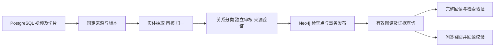

# 视频知识图谱：架构与构建操作

本文是实体关系抽取、知识图谱构建及问答检索的统一入口，按 2026-11-10 的代码整理。
代码能力、历史评测和线上部署是三个不同状态：更新代码或文档不代表生产图谱已经回补。
实际生效版本以运行镜像和每个视频的 `active_build_id` 为准。

## 阅读入口

| 内容 | 文档 |
| --- | --- |
| 实体边界、身份归一、关系方向、来源审核 | [抽取与审核规则](knowledge-graph-extraction.md) |
| 标注数据、评分分母、运行及离线复现 | [实体与关系评测](knowledge-graph-evaluation.md) |
| 各轮指标、失败候选与原始结果入口 | [历史评测汇总](knowledge-graph-evaluation-results.md) |
| 方案取舍、质量审计、token 优化及重构依据 | [实验与演进记录](knowledge-graph-history.md) |
| Neo4j 模型、历史导入、备份及删除对账 | [Neo4j 迁移与运行](neo4j-migration.md) |
| CLI 完整用法、参数与测试连接 | [构图工具说明](../tools/video-knowledge-graph/README.md) |
| 问答侧融合、引用与降级 | [AI 问答](ai-chat.md) |

人工标注阅读稿继续保留：[实体 v3](entity-gold-v3-review.md)、[关系 v3](relation-gold-v3-review.md)。
历史配套数据、人工取舍记录、最新逐项报告和审计样本的入口见评测说明。

## 数据与存储边界



- PostgreSQL 保存原始内容、字幕切片、聊天等业务数据。构图发布前读取并锁定源行，核对来源指纹。
- Neo4j 是当前代码唯一的在线图谱存储，保存实体、别名、关系、证据、任务、租约及检查点。
- Qdrant 继续承担文本向量检索；切片向量化状态不决定是否可以构图。
- 已删除 `VIDEO_GRAPH_BACKEND` 和 PostgreSQL 图谱运行分支。历史模型及 Alembic 仅供兼容和迁移，不代表仍有第二套在线后端。
- 已发布 v1 图谱继续只读展示、检索并保留历史 UUID；新任务只接受 v2 及后续基础版本，所有新投影必须通过独立审核和来源校验。

## 代码职责

图谱代码统一位于 [`backend/app/services/video_graph/`](../backend/app/services/video_graph/)，调用方直接导入职责模块。

| 模块 | 职责 |
| --- | --- |
| `material.py` | 视频/切片模型、源数据读取、指纹、原文定位和源行锁 |
| `extraction.py`、`review.py`、`validation.py` | 模型调用、独立审核、格式修正、凭据和最终质量校验 |
| `identity.py`、`normalization.py`、`semantics.py`、`grounding.py`、`terms.py` | 身份、确定性归一、类型方向、证据约束与术语 |
| `tasks.py`、`storage.py` | 唯一的任务执行流程与 Neo4j 存储、租约、检查点、发布和撤回 |
| `queries.py`、`evidence.py` | 有效投影、遍历、实体别名、关系证据与字幕时间定位 |
| `backfill.py`、`pipeline.py` | 固定范围计划、分批执行、发布与完整回读验证 |
| `request_checkpoint.py`、`usage.py`、`diagnostics.py` | 请求复用、真实用量统计及脱敏错误诊断 |

问答/API 共用 [`graph_retrieval.py`](../backend/app/services/graph_retrieval.py)；
[`answer_graph.py`](../backend/app/services/answer_graph.py) 回到业务切片校验当前来源、生命周期和过滤条件。
旧 `video_graph.py`、`video_graph_*.py` 及 `neo4j_graph/` 已删除，没有导入转发层。

## 配置

| 配置 | 含义 |
| --- | --- |
| `SYNC_DATABASE_URL` | 构图读取的业务 PostgreSQL；与 API 的 `DATABASE_URL` 独立，切换或测试时同时核对 |
| `NEO4J_URI`、`NEO4J_USER`、`NEO4J_PASSWORD`、`NEO4J_DATABASE` | 图谱连接；宿主机通常使用 `bolt://localhost:7687`，Compose 内使用 `bolt://neo4j:7687` |
| `LLM_API_KEY`、`BASE_URL`、`LLM_MODEL` | 真实抽取模型配置；缺少密钥不生成模拟图谱 |
| `VIDEO_GRAPH_REQUEST_TIMEOUT_SECONDS` | 单次请求超时，默认 120 秒 |
| `VIDEO_GRAPH_EXTRACTION_EFFORT`、`VIDEO_GRAPH_REASONING_EFFORT` | 抽取与审核推理档位，默认 `none` |

新代码的部署前提、历史迁移及测试实例要求见 [Neo4j 指南](neo4j-migration.md)。
构图命令不代替 PostgreSQL 的 Alembic 升级；`pipeline --dry-run` 不执行数据库初始化。

新建的独立视频图谱容器使用 `.env.video-graph-next`；构图时增加 `--neo4j-env-file .env.video-graph-next`，将结果写入7688端口的新实例。该覆盖只作用于本次CLI。Web已通过独立发布配置连接next库；构建它正在展示的图谱时同样需要此参数。部署、Web切换与单视频验证见[新图谱目标](video-graph-next-2026-11-10.md)。

## 推荐构建流程

在项目根目录运行。`VIDEO_UUID` 替换为实际 `content_item_id`，可以重复指定多个来源。

```bash
# 只读业务原文盘点
.venv/bin/python tools/video-knowledge-graph/build_graph.py inventory --limit 20

# 只读检查计划，不写清单、报告或图谱，也不调用模型
.venv/bin/python tools/video-knowledge-graph/build_graph.py pipeline \
  --content-id VIDEO_UUID --limit 1 \
  --manifest data/video_graph_runs/build.plan.json \
  --report data/video_graph_runs/build.report.json --dry-run

# 抽取、发布、完整回读及检索验证
.venv/bin/python tools/video-knowledge-graph/build_graph.py pipeline \
  --content-id VIDEO_UUID --limit 1 \
  --manifest data/video_graph_runs/build.plan.json \
  --report data/video_graph_runs/build.report.json

# 失败或部分完成时显式重试，沿用同一清单
.venv/bin/python tools/video-knowledge-graph/build_graph.py pipeline --limit 1 \
  --manifest data/video_graph_runs/build.plan.json \
  --report data/video_graph_runs/build.report.json --retry-failed
```

新清单固定范围、来源指纹、原有效构建和目标抽取版本，最多选择 `limit` 条，范围外视频不排队。
计划和报告必须使用不同路径。已有清单恢复时不能静默改变范围或版本，也不能将 `limit` 缩到清单条数以下。
来源或规则变化后使用新的清单。显式指定的记录不存在或已撤回会报错；未指定来源且全库没有候选时，`selected=0` 表示无任务。

传统 `scan/run/watch` 的 `--limit` 仅限制领取数量，扫描仍覆盖指定范围；首次试运行优先使用有界 `pipeline`。
`plan-backfill/backfill` 保留固定计划和分批排队，但不包含 pipeline 的完整查询回查。具体参数见工具说明。

## 完成判据与恢复

构建返回 `success` 后仍需逐项验证，只有最终 `pipeline_summary.status=success` 才以 0 退出。

| 检查 | 要求 |
| --- | --- |
| `source_current`、`active_current` | 来源指纹、目标任务、有效版本一致，视频未撤回或删除 |
| `saved_output_valid` | 发布标记、主题判断、切片范围、覆盖率和审核凭据有效 |
| `graph_complete` | 关闭画布截断和小图筛选，完整回读 |
| `entities_equal`、`relations_equal` | 身份、类型、方向、谓词和全部限定条件与审核输出一致 |
| `mentions_equal`、`evidence_equal` | 提及、切片、原文偏移、断言、字幕来源和时间一致 |
| `retrievable` | 有关系时可通过实体别名回查同版本、同视频的来源证据 |
| `unchanged_during_verification` | 验证结束时来源与有效版本没有并发变化 |

失败、部分完成、证据损坏或来源过期都以 1 退出。完整回读验证的是发布一致性，不等于语义准确率 100%。
摘要只贡献实体；无材料或不相关的视频不虚构关系。前端可能隐藏小型子图，不能用画布显示数量代替入库检查。

首次部分完成可发布通过的切片，但 pipeline 判为 `incomplete`；已有完整图谱时，新版本部分完成保留旧投影。
失败或过期 worker 不能覆盖有效图谱。恢复按数据库真值检查，并复用仍有效的成功切片与阶段请求。
模型调用不在数据库事务内，发布在 Neo4j 事务中校验视频状态、目标版本和租约后切换有效指针。

物理删除 PostgreSQL 源视频不能通过 SQL 外键级联删除 Neo4j 贡献；应先显式撤回，或在删除后扫描对账。
迁移、备份和旧 worker 协调规则见 [Neo4j 指南](neo4j-migration.md)。

## 问答与接口

`/video-graph/*` 路径保持兼容，图谱查询只返回有效、未撤回、未删除的投影。
问答先读取图谱证据，再回当前业务切片验证原文及过滤条件，按切片身份与关键词/向量候选合并后重排。
前端可展开关系、原文、陈述状态和限定条件；`asserted` 仅表示来源明确陈述，不是现实事实已经独立验证。
Neo4j 不可用时图谱 API 返回 503，问答按现有策略回退到文本检索，不回读过期 PostgreSQL 图谱。

历史质量变化、失败方案及线上盘点数字统一见 [实验记录](knowledge-graph-history.md)，
各轮分数统一见 [评测汇总](knowledge-graph-evaluation-results.md)，不能以旧轮次分数替代当前版本验收。
