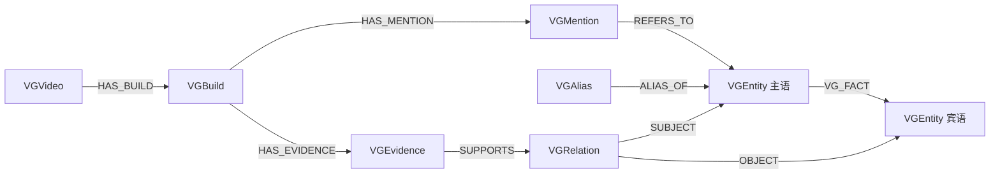

# 视频知识图谱迁移到 Neo4j

本次迁移范围包含实体、别名、关系、证据、视频构图状态、任务、租约和切片检查点。PostgreSQL 继续保存源视频和字幕；Qdrant 继续负责原有向量检索。`VIDEO_GRAPH_BACKEND` 控制图谱 API 和构图脚本使用的后端，默认 `postgres`，导入校验完成后再切换为 `neo4j`。

当前部署已完成切换，数据与测试结果见 [迁移结果报告](neo4j-migration-report-2026-10-21.md)。下文保留可复用的迁移步骤。

## 数据模型

| Neo4j 节点 | 迁移内容 |
|---|---|
| `VGVideo` | 视频标题、链接、撤回状态、期望版本与当前有效版本指针 |
| `VGBuild` | 构图版本、指纹、状态、尝试次数、租约、错误及 `output_json` 检查点 |
| `VGEntity` | 图谱涉及的实体，保留原 UUID |
| `VGAlias` | 类型与归一别名，原 UUID 保留为 `legacy_id` |
| `VGRelation` | 关系 UUID、谓词及限定条件 |
| `VGEvidence` | 关系原文、字符偏移、时间、字幕来源、置信度和陈述状态 |
| `VGMention` | 实体原文提及、切片 ID 和所属构图版本 |



`VG_FACT` 提供实体之间的直接连线，`id` 对应关系 UUID，`predicate` 保存业务关系类型。限定条件保存在关系节点，证据通过关系节点关联。原有八种谓词保持不变；不同限定条件仍对应不同关系。

**有效图谱必须沿视频的 `active_build_id` 筛选证据。** 直接查询所有 `VG_FACT` 会包含历史版本或已撤回的视频曾产生的关系；它们只有被当前有效版本证据支持时才进入 API 和检索。

Neo4j 属性不能直接保存嵌套对象，因此 `output_json`、`qualifiers_json`、`metadata_json` 保存为 JSON 字符串。原有 UUID、状态和检查点内容保留；新实体与关系继续使用原来的稳定 ID 算法。

## 部署服务

配置 `.env`（密码应自行设置或由部署过程生成，不提交到版本库）：

```dotenv
VIDEO_GRAPH_BACKEND=postgres
NEO4J_URI=bolt://neo4j:7687
NEO4J_USER=neo4j
NEO4J_PASSWORD=替换为强密码
NEO4J_DATABASE=neo4j
```

使用独立 Compose 扩展文件，避免已有 PostgreSQL 部署被强制改动：

```bash
docker compose -f docker-compose.deploy.yml -f docker-compose.neo4j.yml up -d neo4j
```

本地基础设施也可将第一个文件替换为 `docker-compose.yml`。Neo4j 使用独立持久化卷 `neo4j-data`、`neo4j-logs`，Browser 和 Bolt 分别绑定到 `127.0.0.1:7474`、`127.0.0.1:7687`。修改端口可设置 `NEO4J_HTTP_PORT`、`NEO4J_BOLT_PORT`。应用镜像需包含更新后的代码及 `neo4j` Python 驱动，依赖已纳入 `pyproject.toml` 与 `uv.lock`。

Neo4j 事务与官方 Python 驱动说明参见 [Neo4j managed transactions](https://neo4j.com/docs/python-manual/current/transactions/)。当前实现使用显式事务，把视频状态锁定、租约校验与发布作为同一个图数据库事务执行；模型调用在事务之外进行。

## 历史迁移

迁移期间停止旧构图 worker（含 `watch` 和外部定时触发），并暂停会更新或删除源视频的操作。允许原系统只读浏览。导出工具拒绝仍含 `running` 状态任务的快照；若存在遗留运行任务，先在旧后端恢复并完成，再导出。

在项目根目录运行；宿主机连接 Neo4j 时覆盖 `NEO4J_URI`：

```bash
# PostgreSQL 连接读取 SYNC_DATABASE_URL；生产容器内运行可使用现有连接配置
.venv/bin/python tools/video-knowledge-graph/migrate_neo4j.py export \
  --snapshot data/video_graph_runs/neo4j-snapshot.json

NEO4J_URI=bolt://localhost:7687 .venv/bin/python \
  tools/video-knowledge-graph/migrate_neo4j.py import \
  --snapshot data/video_graph_runs/neo4j-snapshot.json

NEO4J_URI=bolt://localhost:7687 .venv/bin/python \
  tools/video-knowledge-graph/migrate_neo4j.py verify \
  --snapshot data/video_graph_runs/neo4j-snapshot.json
```

导出使用 PostgreSQL `REPEATABLE READ` 一致性快照，不修改源表，也不调用模型。快照包含全部历史构图任务、现存图谱证据、别名及图谱引用的实体；不搬运其他业务独立使用的实体。输出文件禁止覆盖已有快照。

首次导入要求目标不存在 `VG*` 业务节点。导入按批写入，同一快照可在中断后再次执行；不同快照不得覆盖已有导入。校验逐节点比较属性，并核对连接端点和直接关系，不只比较数量。校验失败时不要切换后端。迁移快照保留原文和检查点，应按业务数据备份管理。

## 切换及日常运行

完成迁移校验后，将 `.env` 中 `VIDEO_GRAPH_BACKEND` 改为 `neo4j`，使用新代码镜像重新创建应用：

```bash
docker compose -f docker-compose.deploy.yml -f docker-compose.neo4j.yml up -d app
```

图谱 API 路径和响应结构保持兼容，前端无需更换接口。后续 `build_graph.py scan/run/watch/withdraw/restore` 会使用 Neo4j 保存任务和图谱，源材料仍从 PostgreSQL 读取。`inventory` 和 `--dry-run` 仅访问源数据库。

```bash
VIDEO_GRAPH_BACKEND=neo4j NEO4J_URI=bolt://localhost:7687 \
  .venv/bin/python tools/video-knowledge-graph/build_graph.py scan

VIDEO_GRAPH_BACKEND=neo4j NEO4J_URI=bolt://localhost:7687 \
  .venv/bin/python tools/video-knowledge-graph/build_graph.py run --limit 5
```

保留原有部分完成语义：首次可发布通过校验的切片，新构图版本部分完成时保留旧有效图谱，失败保留检查点；租约过期后可被新 worker 接管。所有图谱状态修改先锁定所属视频，再检查任务租约 token 和期望版本，防止旧 worker 提交。

PostgreSQL 与 Neo4j 之间没有分布式事务：发布时读取并锁定当前源视频和切片，核对指纹，再提交 Neo4j 事务。物理删除源视频无法再通过 SQL 外键直接级联 Neo4j；`scan/run/watch` 扫描时会在扫描范围内将不存在的源视频标为删除并撤回。删除与下一次扫描之间，图谱可能暂时仍显示旧贡献，运维应在删除后执行扫描或先显式撤回。

旧 PostgreSQL 图谱表保留作为迁移时的备份，切换后不再同步新增构图结果。切回 `postgres` 只能恢复到旧表的状态，不能把它视为持续同步的热备；若 Neo4j 已产生新任务或新证据，应先备份 Neo4j，再单独规划反向迁移。不要同时运行两个后端的构图 worker。

## 验证

```bash
# 不需要数据库的契约与语义测试；Neo4j 集成测试未配置时跳过
.venv/bin/pytest -q backend/tests/test_video_graph_semantics.py \
  backend/tests/test_video_graph_diagnostics.py backend/tests/test_neo4j_graph.py
```

Neo4j 集成测试需显式设置 `NEO4J_TEST_URI`、`NEO4J_TEST_PASSWORD`，可选 `NEO4J_TEST_DATABASE`。测试拒绝含任何 `VG*` 节点的图谱，并清理自己在空图谱中生成的数据；应使用独立测试实例，切勿在已迁入业务数据的实例上运行。测试覆盖有效证据、跨视频关系、撤回恢复、部分完成、版本替换、过期租约、检查点恢复及导入校验。

现有“数据库”管理页仍浏览 PostgreSQL 表，因此其中旧图谱表是迁移备份，不代表切换后的实时图谱。实时图谱继续使用“视频知识图谱”页面，也可在 Neo4j Browser 中查询。例如只查看当前有效关系及证据数：

```cypher
MATCH (v:VGVideo)-[:HAS_BUILD]->(b:VGBuild)-[:HAS_EVIDENCE]->(e:VGEvidence)-[:SUPPORTS]->(r:VGRelation)
WHERE v.active_build_id = b.id AND NOT v.withdrawn AND NOT coalesce(v.deleted, false)
MATCH (r)-[:SUBJECT]->(s:VGEntity), (r)-[:OBJECT]->(o:VGEntity)
RETURN s, r, o, count(e) AS evidence_count
ORDER BY evidence_count DESC
LIMIT 100;
```
