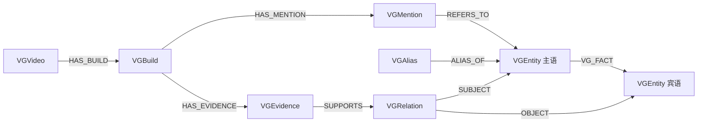

# 视频知识图谱迁移到 Neo4j

迁移范围包含实体、别名、关系、证据、视频构图状态、任务、租约和切片检查点。PostgreSQL 继续保存源视频和字幕；Qdrant 继续负责原有向量检索。2026-11-10 的代码已统一为仅使用 Neo4j，后端切换项已删除；模块职责及存量兼容策略见[架构与构建操作](knowledge-graph.md)。代码更新不代表新镜像已部署。

2026-10-21 已完成 Neo4j 切换，当日数据与测试结果合并于本文的[历史迁移结果](#neo4j-migration-report-2026-10-21)。下文保留可复用的迁移步骤；历史数量不代表实时状态。

## 数据模型

| Neo4j 节点 | 迁移内容 |
|---|---|
| `VGVideo` | 视频标题、链接、撤回状态、期望版本与当前有效版本指针 |
| `VGBuild` | 构图版本、指纹、状态、尝试次数、租约、错误及 `output_json` 检查点 |
| `VGEntity` | 图谱涉及的实体，保留原 UUID |
| `VGAlias` | 类型与归一别名，原 UUID 保留为 `legacy_id` |
| `VGRelation` | 关系 UUID、谓词及限定条件 |
| `VGEvidence` | 关系原文、字符偏移、时间、字幕来源、置信度和陈述状态 |
| `VGMention` | 实体原文提及、切片 ID 和所属构图版本 |



`VG_FACT` 提供实体之间的直接连线，`id` 对应关系 UUID，`predicate` 保存业务关系类型。限定条件保存在关系节点，证据通过关系节点关联。历史导入保留原谓词；v2 新增谓词见[抽取规则](knowledge-graph-extraction.md#关系谓词与方向)。不同限定条件仍对应不同关系。

**有效图谱必须沿视频的 `active_build_id` 筛选证据。** 直接查询所有 `VG_FACT` 会包含历史版本或已撤回的视频曾产生的关系；它们只有被当前有效版本证据支持时才进入 API 和检索。

Neo4j 属性不能直接保存嵌套对象，因此 `output_json`、`qualifiers_json`、`metadata_json` 保存为 JSON 字符串。原有 UUID、状态和检查点内容保留；新实体与关系继续使用原来的稳定 ID 算法。

## 部署服务

配置 `.env`（密码应自行设置或由部署过程生成，不提交到版本库）：

```dotenv
NEO4J_URI=bolt://neo4j:7687
NEO4J_USER=neo4j
NEO4J_PASSWORD=替换为强密码
NEO4J_DATABASE=neo4j
```

使用独立 Compose 扩展文件，避免已有 PostgreSQL 部署被强制改动：

```bash
docker compose -f docker-compose.deploy.yml -f docker-compose.neo4j.yml up -d neo4j
```

本地基础设施也可将第一个文件替换为 `docker-compose.yml`。Neo4j 使用独立持久化卷 `neo4j-data`、`neo4j-logs`，Browser 和 Bolt 分别绑定到 `127.0.0.1:7474`、`127.0.0.1:7687`。修改端口可设置 `NEO4J_HTTP_PORT`、`NEO4J_BOLT_PORT`。应用镜像需包含更新后的代码及 `neo4j` Python 驱动，依赖已纳入 `pyproject.toml` 与 `uv.lock`。

Neo4j 事务与官方 Python 驱动说明参见 [Neo4j managed transactions](https://neo4j.com/docs/python-manual/current/transactions/)。当前实现使用显式事务，把视频状态锁定、租约校验与发布作为同一个图数据库事务执行；模型调用在事务之外进行。

## 历史迁移

迁移期间停止旧构图 worker（含 `watch` 和外部定时触发），并暂停会更新或删除源视频的操作。允许原系统只读浏览。导出工具拒绝仍含 `running` 状态任务的快照；若存在遗留运行任务，先在旧后端恢复并完成，再导出。

在项目根目录运行；宿主机连接 Neo4j 时覆盖 `NEO4J_URI`：

```bash
# PostgreSQL 连接读取 SYNC_DATABASE_URL；生产容器内运行可使用现有连接配置
.venv/bin/python tools/video-knowledge-graph/migrate_neo4j.py export \
  --snapshot data/video_graph_runs/neo4j-snapshot.json

NEO4J_URI=bolt://localhost:7687 .venv/bin/python \
  tools/video-knowledge-graph/migrate_neo4j.py import \
  --snapshot data/video_graph_runs/neo4j-snapshot.json

NEO4J_URI=bolt://localhost:7687 .venv/bin/python \
  tools/video-knowledge-graph/migrate_neo4j.py verify \
  --snapshot data/video_graph_runs/neo4j-snapshot.json
```

导出使用 PostgreSQL `REPEATABLE READ` 一致性快照，不修改源表，也不调用模型。快照包含全部历史构图任务、现存图谱证据、别名及图谱引用的实体；不搬运其他业务独立使用的实体。输出文件禁止覆盖已有快照。

首次导入要求目标不存在 `VG*` 业务节点。导入按批写入，同一快照可在中断后再次执行；不同快照不得覆盖已有导入。校验逐节点比较属性，并核对连接端点和直接关系，不只比较数量。校验失败时不要启用新图谱服务。迁移快照保留原文和检查点，应按业务数据备份管理。

## 切换及日常运行

完成迁移校验并配置 `NEO4J_*` 连接后，使用新代码镜像重新创建应用：

```bash
docker compose -f docker-compose.deploy.yml -f docker-compose.neo4j.yml up -d app
```

图谱 API 路径和响应结构保持兼容，前端无需更换接口。后续 `build_graph.py scan/run/watch/withdraw/restore` 会使用 Neo4j 保存任务和图谱，源材料仍从 PostgreSQL 读取。`inventory` 仅访问源数据库；`pipeline --dry-run` 还读取 Neo4j 状态，但不写入数据。

```bash
NEO4J_URI=bolt://localhost:7687 \
  .venv/bin/python tools/video-knowledge-graph/build_graph.py scan

NEO4J_URI=bolt://localhost:7687 \
  .venv/bin/python tools/video-knowledge-graph/build_graph.py run --limit 5
```

保留原有部分完成语义：首次可发布通过校验的切片，新构图版本部分完成时保留旧有效图谱，失败保留检查点；租约过期后可被新 worker 接管。所有图谱状态修改先锁定所属视频，再检查任务租约 token 和期望版本，防止旧 worker 提交。

PostgreSQL 与 Neo4j 之间没有分布式事务：发布时读取并锁定当前源视频和切片，核对指纹，再提交 Neo4j 事务。物理删除源视频无法再通过 SQL 外键直接级联 Neo4j；`scan/run/watch` 扫描时会在扫描范围内将不存在的源视频标为删除并撤回。删除与下一次扫描之间，图谱可能暂时仍显示旧贡献，运维应在删除后执行扫描或先显式撤回。

旧 PostgreSQL 图谱表保留作为迁移时的备份，切换后不再同步新增构图结果。当前代码已删除 PostgreSQL 图谱后端，不能通过环境变量切回旧表；回退需要旧代码镜像和相应时间点的数据备份。不要同时运行旧 PostgreSQL 构图 worker 和新 Neo4j worker。

## 验证

```bash
# 不需要数据库的契约与语义测试；Neo4j 集成测试未配置时跳过
.venv/bin/pytest -q backend/tests/test_video_graph_semantics.py \
  backend/tests/test_video_graph_diagnostics.py backend/tests/test_neo4j_graph.py
```

Neo4j 集成测试需显式设置 `NEO4J_TEST_URI`、`NEO4J_TEST_PASSWORD`，可选 `NEO4J_TEST_DATABASE`。测试拒绝含任何 `VG*` 节点的图谱，并清理自己在空图谱中生成的数据；应使用独立测试实例，切勿在已迁入业务数据的实例上运行。测试覆盖有效证据、跨视频关系、撤回恢复、部分完成、版本替换、过期租约、检查点恢复及导入校验。

现有“数据库”管理页仍浏览 PostgreSQL 表，因此其中旧图谱表是迁移备份，不代表切换后的实时图谱。实时图谱继续使用“视频知识图谱”页面，也可在 Neo4j Browser 中查询。例如只查看当前有效关系及证据数：

```cypher
MATCH (v:VGVideo)-[:HAS_BUILD]->(b:VGBuild)-[:HAS_EVIDENCE]->(e:VGEvidence)-[:SUPPORTS]->(r:VGRelation)
WHERE v.active_build_id = b.id AND NOT v.withdrawn AND NOT coalesce(v.deleted, false)
MATCH (r)-[:SUBJECT]->(s:VGEntity), (r)-[:OBJECT]->(o:VGEntity)
RETURN s, r, o, count(e) AS evidence_count
ORDER BY evidence_count DESC
LIMIT 100;
```

<a id="neo4j-migration-report-2026-10-21"></a>

## Neo4j 视频知识图谱迁移结果

以下按 2026-10-21 的原迁移记录保留。“当前部署”、配置、快照数量和验证结果均指当日；`VIDEO_GRAPH_BACKEND` 已从新代码移除。

2026 年 10 月 21 日完成代码适配、历史数据导入和正式应用切换。

### 当前部署

- 正式应用镜像：`rag-video-graph-neo4j:20261021`。
- 图谱后端：`VIDEO_GRAPH_BACKEND=neo4j`，图谱、任务、租约和检查点均存于 Neo4j。
- Neo4j：`neo4j:5.26-community`，容器 `intelligence-rag-neo4j`，持久化卷独立保存数据与日志。
- 源视频及字幕仍保存在 PostgreSQL，Qdrant 仍承担原有向量检索。
- Neo4j Browser：`http://localhost:7474`，用户名 `neo4j`，密码位于本机 `.env` 的 `NEO4J_PASSWORD`；端口仅绑定本机。
- 应用与 Neo4j 均通过容器健康检查，临时验证应用已停止。

### 数据核对

导出使用 PostgreSQL 一致性快照。下载镜像中断后再次导出，校验和与原快照完全一致：

```text
3be6dbf50580b676d5f6a835b9ea8423fabb1f2aac8fc853f34b2e690318ad9a
```

| 迁移对象 | 数量 |
|---|---:|
| 视频构图状态 | 483 |
| 构图任务 | 483 |
| 实体 | 2,817 |
| 别名 | 2,819 |
| 关系 | 2,130 |
| 关系证据 | 2,215 |
| 实体提及 | 4,333 |

逐节点属性和所有连接端点校验通过，关系直连 `VG_FACT` 也与源关系逐一对应。历史任务状态原样保留：213 个成功、20 个部分完成、250 个失败；这些失败是已有抽取任务状态，并非迁移失败。当前有效构图版本覆盖 233 个视频。

切换时 PostgreSQL 源视频共 642 条，构图任务数为 483；尚未构图的源视频未被当作已完成任务迁入。中断期间源视频从 639 增至 642，重新读取旧后端总览后，新旧后端统计一致。

### 验证结果

- Neo4j 实例上的测试：7 项通过，覆盖有效证据、跨视频关系、撤回恢复、部分完成、版本替换、租约接管、并发领取、检查点恢复、导入校验以及故障时返回 503。
- 图谱与部署回归：39 项通过，31 项数据库相关测试因未提供对应测试连接而跳过；之后单独运行了上述 Neo4j 实例测试。
- 静态检查：修改涉及的 Python 文件通过 Ruff，`git diff --check` 通过。
- 临时应用和正式应用均对比了总览、子图、实体列表、关系证据、视频状态、检索上下文六类接口；忽略按 ID 排序的列表顺序后，结果均与旧后端一致。
- 正式容器确认 `graph_backend=neo4j`。对一个已有成功视频执行 `scan`，结果为 `scanned=1, queued=0, unchanged=1`。
- 迁移和验证未调用真实抽取模型，也未重新抽取历史字幕。

### 产物与后续运行

本机产物目录：`data/video_graph_runs/neo4j-migration-20261021/`（业务数据目录不随 Git 分发）。

- `snapshot.json`：完整迁移快照。
- `import-report.json`：逐属性与连接校验报告。
- `api-before.json`、`api-before-fresh.json`：旧后端接口基线。
- `api-after-18000.json`、`api-after-8000.json`：临时及正式 Neo4j 后端接口结果。
- `previous-settings.json`：切换前的镜像和后端配置，不含密码。

PostgreSQL 原图谱表保留为迁移时备份，切换后不再同步新图谱结果。回切旧后端不能保留 Neo4j 中后来产生的更新，需要另行规划反向迁移。既有失败与部分完成任务仍需按需显式重试。

后续部署、构图命令、删除对账及备份语义见 [Neo4j 迁移指南](neo4j-migration.md)。
