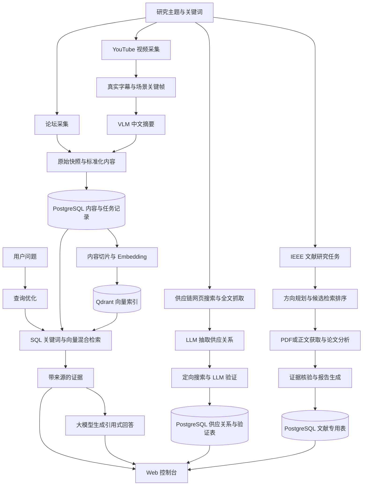

# 情报采集与大模型分析系统：整体思路、流程与子项进展

整理日期：2026 年 10 月 11 日。

本文依据当前项目代码、部署配置及已有文档整理。数据规模引用 [2026 年 10 月 9 日数据库统计](intelligence-database-summary.md)，本次未重新查询数据库、核对 Qdrant 点数或执行外部采集任务。下文将代码已实现、历史数据产出与后续建议分开描述；已有产出不等于当前所有外部服务持续可用。

## 一、系统整体思路

系统面向无人机技术、故障与安全、产业供应链和学术研究，构建“公开信息采集 → 证据保存 → 内容加工 → 大模型分析 → 检索与展示”的工作流程。

采集程序负责获得真实材料，大模型负责将材料转化为便于阅读、检索和判断的结果。论坛提供技术讨论和故障经验，视频提供讲解与视觉线索，网页提供供应关系线索，论文提供研究方法和实验依据。模型分别用于视频中文摘要、供应关系抽取与复核、论文研究方向规划与分析，以及基于检索证据的问答。

系统保留来源链接、原文或原始快照、任务记录和证据定位，使分析结果能够回溯。当前采用两类处理路径：

- **通用情报 RAG 路径**：论坛与视频进入统一内容表，切片后建立向量索引，供检索和 AI 问答使用。
- **专题分析路径**：供应链和文献使用专用表，形成供应关系、验证记录、论文分析和研究报告，通过专题页面查看。

当前供应链和文献尚未统一接入通用 `/search`、`/answer` 的证据检索链路，因此跨四类来源的统一问答属于后续扩展。

## 二、总体架构与数据流

| 组件 | 职责 | 当前实现位置 |
|---|---|---|
| 采集工具 | 分来源搜索、抓取、去重、加工和入库 | `tools/forum-crawler`、`tools/video-crawler`、`tools/supplier-information` |
| 后端 API | 提供数据源、运行记录、内容、检索问答、供应链与文献接口 | `backend/app/api` |
| 通用 worker | 处理排队采集任务，保存原始页面，标准化内容并索引 | `worker/app` |
| 文献 worker | 独立执行文献研究任务，维护进度、证据与产物 | `backend/app/literature`、`scripts/run_literature_worker.py` |
| PostgreSQL | 保存业务事实、原始快照、任务事件、证据和专题分析结果 | `backend/app/models`、`backend/alembic` |
| Qdrant | 保存内容切片向量与检索所需 payload | `backend/app/services/retrieval.py` |
| Web 前端 | 展示总览、采集状态、内容、检索问答和专题分析 | `frontend/src/pages` |
| 调度与部署 | 定时触发四类采集任务，提供容器运行及宿主机任务控制 | `deploy`、`scripts/scheduler_bridge.py` |

PostgreSQL 是事实来源，Qdrant 是可重建的检索索引。前端通过后端 API 访问数据。采集工具既有直接入库流程，也有通用 worker 流程，并非全部经过同一个队列。

## 三、数据采集搭配大模型分析的具体流程

### 1. 确定主题并发现候选材料

论坛使用短概念词搜索 ArduPilot、PX4 等公开帖子；视频使用 YouTube Data API 搜索候选；供应链通过百度搜索获得网页；文献研究由模型将用户问题展开为多个 IEEE 检索方向。定时采集通过轮换关键词扩大覆盖，并跳过已处理材料。

### 2. 获取真实材料并保留来源

论坛抓取帖子正文，记录主题、作者、时间和互动信息。视频优先获取真实字幕，在允许且具备依赖时可使用本地 Whisper 转写；同时提取场景关键帧并保存时间戳。供应链保存搜索与全文 Markdown 产物。文献保存元数据，并按访问权限尝试获取 PDF 和正文。

通用 worker 在调用页面抽取接口前先持久化原始页面。各专用流程的原始产物存储形式不同：内容快照进入数据库，供应链有文件产物，视频关键帧为本地图片，文献 PDF 可保存为数据库二进制产物。

### 3. 清洗、去重并形成可分析内容

论坛以来源、标准链接及内容哈希构造去重标识；视频以标准视频链接识别重复候选；供应链维护 URL 增量索引，并更新已识别关系；论文通过专用记录关联研究任务与候选论文。

论坛和视频统一保存到 `content_items`，切片进入 `content_chunks`。视频将中文摘要与带起止秒数的字幕片段作为不同证据类型保存，便于检索后定位。

### 4. 按材料类型调用模型

| 分析环节 | 模型输入 | 模型作用与输出 | 当前边界 |
|---|---|---|---|
| 视频理解 | 真实字幕、关键帧、视频信息 | VLM 生成中文摘要，进入内容库和索引 | 依赖字幕或转写、视频流访问及 VLM 服务；摘要质量需持续检查 |
| 供应关系抽取 | 网页全文与来源 URL | 抽取采购方、供应商、供应模块、可信度和原文依据 | “明确”是抽取分类，仍需独立验证 |
| 供应关系验证 | 定向搜索获得的新网页全文及原始线索 | 输出“确认 / 否定 / 待确认”、可信度和证据链接 | 证据不足与执行失败需区分；同名企业和名称变体仍会影响结果 |
| 文献研究 | 用户问题、论文元数据、摘要及可获取正文 | 生成检索方向、中文摘要、匹配解释和研究结论，汇总报告 | 正文无法获取时，不能视作完成全文分析 |
| 查询优化 | 用户问题与筛选条件 | DeepSeek 生成检索表达、关键词与实体提示 | `LLM_PROVIDER` 默认是 `fake`，实际调用需配置 `deepseek` |
| RAG 回答 | 检索到的编号证据 | DeepSeek 生成带 `[n]` 引用的回答 | 当前最多使用前 3 条证据；未配密钥或调用失败时返回证据片段拼接 |

通用页面抽取接口当前仍为 fake / fallback 实现，尚未接入真实通用 LLM 抽取服务。真实模型能力主要落在视频、供应链、文献和检索问答的专用流程中。

### 5. 建立索引并按证据回答

默认 Embedding 配置为硅基流动 `BAAI/bge-m3`、1024 维，也支持本地模型。内容切片向量写入 Qdrant，数据库记录索引状态、向量点 ID 和处理时间。更换模型后需重建索引，避免维度或语义空间不一致。

用户检索时，系统执行查询优化，再合并 SQL 关键词与向量检索结果，进行去重、排序和数据库回查，返回带来源的证据。向量检索失败时可以继续 SQL 检索，并在 trace 中记录失败。问答提示词要求模型依据证据回答并引用来源，但当前并未对生成答案的每项事实执行自动原文核验。

文献流程另外实现了引文定位核验：在标题、摘要与正文页中寻找模型给出的证据，找不到时清空证据并降级为关键词匹配。这验证的是引用能否在材料中定位，并不等于研究结论已得到全面验证。

### 6. 展示、监控与增量更新

控制台展示内容、采集运行、错误事件、检索证据、供应关系和文献报告。宿主机调度桥接可读取四类固定 systemd 任务的状态，并通过受限接口手动启动任务。任务锁防止重复执行，供应链采集与验证共享锁以避免文件冲突。

## 四、各子项进展

### 1. 论坛情报采集

**进展：已实现采集、增量去重、入库与通用 RAG 接入，已有真实数据。**

- 支持 ArduPilot / PX4 Discourse 搜索与帖子正文入库，提供定时关键词轮换脚本。
- 支持 DJI Lito 系列主题和评论的专用导入。
- 10 月 9 日统计共 213 条：ArduPilot 100 条、PX4 93 条，DJI 主题和评论各 10 条。
- 内容覆盖 GPS 欺骗与干扰、MAVLink 安全、EKF、失控、ESC、RTK 等主题，可通过内容详情和检索页面查看。

**待完善：**扩大论坛及设备覆盖，建立内容相关性与更新质量评估。DJI 专用导入不在当前四类定时任务白名单中；不能据此认定 DJI 已纳入常态化采集。

代码入口：[Discourse 入库](../tools/forum-crawler/scripts/discourse_ingest.py)、[DJI 导入](../tools/forum-crawler/scripts/ingest_dji_lito.py)。

### 2. 视频多模态情报采集

**进展：已实现搜索、字幕或转写、关键帧、VLM 摘要和向量入库，已有真实数据。**

- 搜索支持关键词轮换、状态持久化、跨页查重，按成功入库目标处理候选。
- 字幕、场景关键帧与中文摘要组成视频证据；字幕切片保存起止时间。
- 10 月 9 日统计共 334 条视频；切片包含 3,712 条字幕片段和 327 条视频摘要切片。这是现有数据分布，并非每条视频都具备完整证据。

**待完善：**提升无人机主题筛选和摘要质量，补齐视频发布时间字段，检查字幕和关键帧完整性。真实采集依赖 YouTube API、网络出口、字幕或 Whisper、VLM 配置，仍需持续验证外部链路稳定性。

代码入口：[搜索采集入口](../tools/video-crawler/scripts/main.py)、[视频证据处理](../tools/video-crawler/scripts/youtube_transcript_evidence.py)。

### 3. 供应链情报抽取与验证

**进展：已实现“搜索抓全文 → 抽取关系 → 独立定向验证 → 数据库与页面展示”，已有真实关系和验证记录。**

- 抽取流程维护关系文件并回写 `supplier_relations`；验证流程当前从数据库选择目标，追加 `supplier_verifications` 并回写执行状态。
- 10 月 9 日统计有 63 条供应关系和 63 条验证记录，采购方均为“大疆”；验证判定为 22 条“确认”、41 条“待确认”。
- 关系表执行状态为 39 条“已验证”、24 条“验证失败”。“已验证”表示流程完成，不等于判定为“确认”；失败结果可归一为“待确认”。
- 已实现验证记录关联、验证先到时补建关系，以及依据审计记录同步展示状态。

**待完善：**归并企业名称变体，区分母子公司与未指名供应商集合，提高权威来源覆盖，处理验证失败和待确认项。当前关系记录数不能直接作为独立企业数量，关系抽取与验证也尚未接入通用 RAG。

代码入口：[抽取流程](../tools/supplier-information/pipeline.py)、[独立验证](../tools/supplier-information/supplier_verify.py)、[数据库回写](../tools/supplier-information/db_ingest.py)。

### 4. IEEE 文献研究

**进展：已实现研究任务、方向规划、检索排序、正文获取、论文分析、证据核验和报告产出，已有成功样例。**

- 文献 worker 独立运行，前端支持查看任务进度、结果与产物，后端支持取消任务。
- 10 月 9 日统计有 11 篇论文、7 次研究任务，其中 3 次成功、4 次失败；保存 43 个产物、102 条证据和 3 份最终报告。
- 11 篇论文都有摘要与 PDF 链接，实际保存 PDF 和全文的各为 3 篇，不能将全部论文视为已完成全文获取。

**待完善：**排查失败任务原因，提高全文获取与分析成功率，扩大研究主题，并评估报告质量。IEEE 授权访问依赖浏览器登录配置，当前文献流程要求单 worker 使用浏览器 profile；尚未接入通用问答。

代码入口：[文献流水线](../backend/app/literature/pipeline.py)、[分析与证据核验](../backend/app/literature/llm.py)。使用说明见 [文献研究文档](literature-research.md)。

### 5. 通用存储、向量检索与 AI 问答

**进展：统一内容模型、切片与索引、混合检索、证据展示和引用式问答已实现。**

- 10 月 9 日统计通用内容共 547 条，切片共 4,592 条；其中 4,090 条在 PostgreSQL 中标记为成功写入 Qdrant，502 条待处理，未独立核对实际向量点数。
- 检索记录查询优化及检索 trace，支持来源等过滤；视频类型过滤下实现证据去重。
- 问答支持真实 DeepSeek 调用及失败降级，已有相关单元测试和演示冒烟脚本。

**待完善：**处理待索引切片，核对数据库与 Qdrant 一致性，建立检索召回、相关性和引用质量评估。实体、实体提及与模型调用表虽有定义，10 月 9 日统计均为空，实体分析和统一模型调用审计尚未形成实际数据闭环。

代码入口：[检索服务](../backend/app/services/retrieval.py)、[问答编排](../backend/app/services/search.py)、[索引重建](../scripts/reindex_embeddings.py)。

### 6. 前端控制台与运行可观测性

**进展：系统监控与工作空间页面已实现。**

前端包含总览、数据源、运行记录、内容详情、数据库、检索、AI 问答、供应链和文献研究九类视图。数据库浏览需显式启用配置；数据源页面通过调度桥接展示真实任务状态，未部署桥接时明确提示不可用。

**待完善：**将采集量、业务成功率、证据完整度、索引积压和模型调用情况汇总为可持续跟踪的质量指标。页面静态“系统在线”文案以及采集进程退出码，都不能单独证明所有业务链路正常。

代码入口：[前端页面入口](../frontend/src/App.tsx)、[任务控制说明](scheduled-task-control.md)。

### 7. 定时调度与部署交付

**进展：已提供 Docker Compose、任务 runner、systemd 定时模板与受限调度桥接；已有隔离环境验证记录。**

- 四类定时任务为视频采集、论坛采集、供应链抽取、供应链验证，模板均按两小时间隔错峰执行。模板存在不代表目标机已安装并启用。
- 部署 runner 支持锁、超时、任务容器清理和依赖检查；配置包含 PostgreSQL、Qdrant 与产物持久化。
- 已有验证记录报告 21 项部署相关测试通过，并完成隔离 Compose 启动、迁移、健康接口、首页和任务依赖检查。

**待完善：**完成目标服务器部署验收与真实外部采集验证。历史记录中，最终源码的干净全量镜像重建未完成；`tests/unit` 曾有 36 项基线失败，主要涉及旧 `skills/` 路径与过期演示断言。本次仅整理文档，未复跑这些测试，不能据此宣称当前全量测试通过。

部署说明见 [Linux 服务器部署指南](linux-server-deployment.md)，证据与限制见 [部署验证记录](deployment-validation.md)。工具目录已统一为 `tools/`，当前配置和测试应使用 `tools/forum-crawler`、`tools/video-crawler` 等路径；历史验证记录保留当时的问题描述。

## 五、当前阶段判断与后续建议

当前项目已形成多来源情报采集与分析原型，拥有论坛和视频的通用 RAG 路径，以及供应链、文献两个专题分析流程。现有数据证明各业务已产生实际成果；仍需补齐统一检索、模型审计、质量评估和部署验收，才能进一步判断长期运行效果。

建议按以下顺序推进：

1. **巩固现有采集与索引**：排查文献失败、供应链验证失败和待索引切片，核对实际向量状态，建立业务成功率与证据完整度指标。
2. **完善质量控制**：优化视频相关性、企业名称归并和权威证据筛选；建立固定问题集评估检索与回答，增加生成答案的引用核验。
3. **统一分析入口**：将经过验证的供应关系和文献证据转换为可检索内容，使一个问题能够汇总论坛、视频、网页与论文材料。
4. **补齐模型与运维闭环**：接入真实通用页面抽取、统一模型调用审计与费用记录，修复历史测试路径，完成干净构建和目标服务器真实业务验收。

## 六、相关文档

- [项目 README](../README.md)：环境、开发命令与演示路径。
- [情报数据库数据概览](intelligence-database-summary.md)：2026 年 10 月 9 日规模、字段与覆盖边界。
- [文献研究](literature-research.md)：IEEE 访问和独立 worker 使用。
- [定时采集控制](scheduled-task-control.md)：宿主机桥接、任务状态与手动触发。
- [Linux 服务器部署指南](linux-server-deployment.md)：部署、持久化与验收。
- [部署验证记录](deployment-validation.md)：已执行验证及未验证事项。
