# 无人机供应链情报分析与挖掘关键技术报告（第 2～4 部分）

---

## 2. 无人机供应链情报分析与挖掘关键技术方案

### 2.1 总体技术架构

面向无人机供应链情报获取、结构化治理与通信/飞控体制分析任务需求，本系统采用**“多源采集与资料获取 → 多模融合存储与索引 → 核心解析与知识图谱构建 → 检索分析与应用服务”**的四层协同技术架构，形成从公开情报汇聚、多模态技术资料解析到证据可溯源问答的端到端技术闭环。

```mermaid
flowchart TD
    subgraph 多源采集与资料获取层
        S1[供应链网页与官方白皮书采集]
        S2[多品牌官方手册与技术参数采集]
        S3[开源飞控与技术社区论坛采集]
        S4[视频多模态与拆解维修资料采集]
        S5[通用专题网页与学术文献采集]
    end

    subgraph 多模融合存储与索引层
        PG[(关系型业务与证据库<br/>结构化供应链 / 原文快照 / 任务台账)]
        QD[(向量检索引擎<br/>多语言高维稠密向量索引)]
        NJ[(图数据库<br/>多源融合知识图谱与源投影)]
    end

    subgraph 核心解析与知识图谱构建层
        P1[多模态文档解析与版面定位]
        P2[两阶段供应链抽取与独立核验]
        P3[论坛/视频准入门控与事实抽取]
        P4[统一图谱契约与原子化版本投影]
    end

    subgraph 检索分析与应用服务层
        API[混合检索 / 语义重排 / 证据增强 GraphRAG 服务]
        UI[无人机供应链情报分析与可视化平台]
    end

    S1 --> P2 --> PG
    S2 --> P1 --> P4
    S3 & S4 --> P3 --> P4
    S2 & S3 & S4 & S5 --> PG --> QD
    P4 --> NJ
    PG & QD & NJ --> API --> UI
```

总体架构围绕以下三大核心原则设计：
1. **双轨协同的数据治理体系**：将通用技术资料（论坛讨论、拆解维修指南、视频字幕与摘要、技术手册切片、学术论文）纳入统一内容索引链路，支撑跨源语义检索与问答；将高度结构化的供应链关系、验证记录及跨源实体知识沉淀至专用关系库与图数据库，支撑精准查询与多跳溯源。
2. **全链路证据绑定与可回溯设计**：系统保留所有情报的原始链接、网页或文档快照、图片裁剪区域、视频时间区间及原文引用片段，确保每一条供应商关系、图谱三元组及智能问答结论均具备可核验的原始依据。
3. **模块化与松耦合可扩展设计**：采集调度、多模态解析、向量索引与图谱构建均支持独立部署、异步执行与按需扩容，可随目标品牌、地区与资料类型的增加平滑扩展。

---

### 2.2 无人机供应链情报获取方案

针对无人机供应链线索分散、技术资料形态多样的特点，系统构建了覆盖**七类公开数据源**的协同情报获取方案，所有采集任务均具备增量去重、内容哈希校验、异常重试与并发锁控制机制：

| 情报类别 | 获取对象与覆盖范围 | 核心获取技术路径 |
|---|---|---|
| **供应链网页与白皮书** | 产业链新闻、拆解报告、厂商公告、财报及官方白皮书 | 多品牌别名策略驱动、双搜索引擎互补检索、动态页面浏览器兜底、两阶段抽取与独立验证 |
| **官方手册与技术参数** | 大疆、Parrot、Autel、Hubsan、Skydio 等多品牌官方手册与规格表 | 官网下载中心与支持接口自动发现、多源并发归档、文件完整性校验、结构化规格提取 |
| **开源飞控与社区论坛** | ArduPilot、PX4 开源社区及厂商技术论坛讨论 | 领域短概念词轮换检索、主题与回复上下文抓取、按标准链接与内容哈希增量入库 |
| **无人机视频多模态资料** | 无人机拆解、硬件评测、飞控调试与故障排查视频 | 视频检索与跨页查重、真实字幕提取与本地语音转写兜底、场景关键帧抽取、视觉摘要生成 |
| **拆解与维修图文指南** | 硬件拆解步骤、内部部件布局及维修指引图文 | 指南结构化解析、质量校验与步骤分块、配图本地化留存与视觉描述绑定 |
| **通用行业与专题网页** | 围绕特定机型、器件或行业动态扩展的公开网页 | 关键词批量检索、时间与站点域过滤、网页正文自动清洗提取与清单化输出 |
| **学术文献资料** | IEEE 无人机通信体制、飞控算法、安全漏洞及硬件相关论文 | 智能检索方向规划、候选论文排序、元数据与全文 PDF 自动获取及引文定位核验 |

各类情报的获取方案与协同方式如下：
1. **供应链专题情报获取与核验**：支持按品牌配置中英文企业名称、别名体系及权威种子源，结合主流中英文搜索引擎实现跨语种互补检索。正文获取采用自动化正文提取与无头浏览器兜底相结合的方式，克服反爬策略与动态渲染限制，并对无常规扩展名的公告类文档自动识别按页解析。在此基础上，通过“关系初抽 → 独立二次搜索 → 交叉核验”两阶段流程，将原始供应线索转化为带可信度评级的结构化供应链情报。
2. **官方技术文档与参数获取**：围绕国内外主流民用及“军用商规”无人机品牌，自动发现并归档用户手册、快速入门、维护指南、安全概要、发布记录及官方技术规格页。采集过程按内容哈希统一去重并保留多入口引用关联，可自动剥离官网新旧版本页面样式差异，结构化还原各型号及衍生军用/行业版本（如 Skydio X10/X10D、X2D 系列等）的硬件配置与性能参数。
3. **开源社区与代码关联情报获取**：针对商用机型飞控与通信源码封闭的特点，重点依托 ArduPilot、PX4 等开源飞控社区开展常态化技术情报采集，定向获取围绕飞控参数配置、MAVLink 通信协议解析、EKF 状态估计、抗干扰与安全脆弱性排查的工程讨论与配置线索，作为剖析无人机飞控与通信体制的重要开源支撑。
4. **视频与拆解维修多模态获取**：通过视频检索获取无人机实物拆解与飞控测试视频，优先提取官方字幕并辅以本地语音识别兜底，结合场景变化检测抽取关键帧图像，利用视觉语言模型生成中文技术摘要；同时导入 iFixit 拆解维修指南，将硬件拆解步骤文本与内部电路板/模组实物配图进行精准关联，形成直观的硬件结构情报。
5. **通用网页与学术文献补充获取**：通过关键词驱动的通用网页采集补充行业动态与芯片/模组厂商资讯；通过自动化文献研究工作流将分析课题拆解为多个学术检索方向，自动完成 IEEE 文献的发现、筛选、全文获取与方法提炼，为协议规则及体制机理分析提供学术理论依据。

---

### 2.3 无人机供应链情报数据库搭建方案

为满足供应链结构化统计、多模态非结构化检索以及多跳关系溯源的综合业务需求，系统搭建了**“关系型核心库 + 向量检索引擎 + 知识图谱库”**三位一体的无人机供应链情报数据库：

1. **关系型核心数据库（结构化业务与原始证据台账）**：
   - **供应链关系与验证表**：围绕整机厂商（采购方）、上游供应商及供应模组类别（整机、飞控模组、通信模组、传感器等）建立规范化主从表结构。主表以“采购方 + 供应商”为唯一主键聚合供应内容、关联无人机型号、证据年份、来源链接集合、原文证据明细及验证状态；验证从表完整记录每次独立复核的时间、结论（确认/否定/待确认）、可信度与新增佐证链，支持按品牌、供应商、模组类型及验证状态多维统计与聚集查询。
   - **多模态内容与专题分库**：建立统一内容主表与切片表，集中管理论坛文本、拆解图文、带起止时间戳的视频字幕与摘要片段；同时针对大规模官方文档与学术文献采用物理分库隔离，确保高并发检索与批量解析互不干扰。
2. **向量语义检索数据库**：
   - 针对通用情报切片与无人机技术文档切片分别构建高维向量集合，采用支持中英跨语种的千维级语义向量模型进行稠密向量编码，并在向量载荷中同步存储来源类型、机型标识与时间属性，支持语义检索与属性过滤融合，且支持索引版本的平滑重建。
3. **知识图谱数据库**：
   - 以图结构存储经过质量审核的多源融合实体、关系事实、属性状态与多源证据链，保留跨来源共享投影与各数据源原生投影，支撑供应商关系网络、硬件装配层级、通信/飞控体制特征的交互式图谱浏览与多跳关联挖掘。
4. **常态化采集与容量可扩展设计**：
   - **常态化调度机制**：结合系统级定时任务调度与任务并发锁控制，周期性驱动论坛、视频、供应链抽取与供应链验证等任务自动运行，通过增量索引与状态检查点避免重复采集与资源浪费。
   - **容量定制化与横向扩展**：业务表内置灵活的扩展字段以适应新增属性；外部文档库、多媒体图片库、向量集合及图谱存储均采用独立持久化数据卷挂载，支持通过增量配置新品牌/新数据源、扩充存储卷及扩展独立图谱/向量分片的方式实现数据库容量的按需定制与平滑扩容。

---

## 3. 核心关键技术

### 3.1 技术难点

在实现无人机供应链多源情报整合与通信、飞控体制深度分析的过程中，主要面临以下三项核心技术难点：

1. **多源情报格式高度异构，复杂版面与图文关联易失真**：无人机供应链与技术资料涵盖网页 HTML、多栏/跨页表格 PDF 白皮书、矢量图标手册、视频流与拆解图文等多种形态。常规文本抽取极易破坏表格合并单元格结构、混淆同页不同部件的示意图与操作说明，或在纯图像识别中产生参数幻觉。
2. **跨源实体名称变体多，供应链层级与作用域易混淆**：同一厂商或核心硬件在不同语料中普遍存在中英文全称、简称、子公司/母公司及别名混用现象；同时，特定机型局部上下文中的指代与全局通用器件名称容易发生误合并，直接对齐易造成知识图谱“实体漂移”或错误的供应归属。
3. **商用及外军无人机内部设计图纸与核心代码获取受限**：主流商用及军用商规无人机通常不公开硬件原理图、PCB 设计及闭源飞控/图传源码，难以直接从单一官方渠道获取完整的内部架构，必须借助官方白皮书器件披露、拆解图文、指示灯/接口手册及开源社区讨论等侧面情报进行交叉推理与解构。

---

### 3.2 关键技术一：无人机多源情报特征解析与功能架构解构技术

针对异构文档解析失真与图文错绑问题，系统构建了面向技术手册、规格表格与多模态视频的精细化特征解析与架构解构技术：

1. **原生文本优先与双轴精确图文定位技术**：
   - 解析官方技术手册 PDF 时，采用“原生文字层优先、视觉模型补充图像区域”的混合策略，最大程度避免视觉大模型直接识别文字引入的数字与型号误读。
   - 通过几何版面聚类与原文档双轴坐标映射，精确裁剪设备外观、接口分布及内部结构局部图，保留物理页码、文本行位置与图像指纹，并引入章节标题边界约束，有效防止同页相邻功能模块（如存储卡槽与通信卡槽）的图文错位绑定。
   - 针对手册中的专业指示灯状态表与硬件符号，结合底层矢量图形与像素颜色测量校验灯态语义，精准还原设备运行状态机、告警编码与交互逻辑。
2. **跨形态规格表格与长文档上下文还原技术**：
   - 兼容新旧两版官网参数页面及复杂 PDF 表格，自动识别机型衍生变体并展开 HTML 跨行/跨列合并单元格，完整保留测试条件与计量单位脚注。
   - 针对超长技术白皮书与报告采用分片解析与元信息跨片传递机制（如封面修订日期与机型上下文透传），确保分散在不同页码中的器件供应线索保持准确的时间与对象归属。
3. **视频时间轴与视觉关键帧联合解构技术**：
   - 将视频真实的语音时间轴切片与场景关键帧变化图像对齐，区分高确定性的原文语音证据与辅助性的视觉摘要证据，在保留直观拆解画面的同时严格控制模型推测误差，辅助还原硬件装配关系与实操故障特征。

---

### 3.3 关键技术二：基于异构数据融合的无人机协议规则与供应链溯源技术

为克服单一来源信息片面性及内部设计/代码受限问题，系统通过“开源社区准入解析 + 供应链两阶段交叉溯源 + 证据增强 GraphRAG”实现协议规则挖掘与供应链可信溯源：

1. **面向通信与飞控体制的准入门控与案例抽取**：
   - 在解析开源飞控社区（ArduPilot/PX4）海量技术帖时，设立强制准入评估门槛，先剔除无关讨论并提取支撑原文区间，再围绕“故障现象—参数配置—操作流程—技术关联”结构化抽取通信协议（如 MAVLink）、飞控状态估计算法（如 EKF）、链路抗干扰特性与固件约束，形成可与公开供应链硬件特征相互印证的体制分析依据。
2. **基于原文严格核验的供应链两阶段溯源**：
   - 第一阶段抽取的供应商与供应模块关系，必须经过“采购方归属校验、来源链接校验与原文引用句精确匹配校验”三重门禁方可入库，从源头上杜绝大模型“无中生有”。
   - 第二阶段独立验证模块围绕待核验供应链关系发起全新定向检索，结合新获取的权威报道、厂商公告及原始线索进行交叉研判，给出清晰的是非结论与审计轨迹，实现对“芯片/模组—整机机型—制造厂商”供应链条的精细化溯源。
3. **证据增强的混合检索与 GraphRAG 问答**：
   - 面对专业分析查询，系统并行执行**关系库关键词检索 + 向量语义检索 + 知识图谱子图召回**。
   - 对图谱召回的关系事实强制执行“原文回查落地（Grounding）”校验，剔除无法映射至真实文本切片的孤立三元组，随后利用跨语种语义重排模型对多路证据进行精排与交错融合，最终驱动大模型严格依据编号证据生成带引用标注的研判结论，并支持多轮上下文追问。

---

### 3.4 关键技术三：知识图谱构建

为实现多源异构情报的知识统一沉淀与高质量演进，系统设计了规范化的多源知识图谱构建技术体系：

1. **来源无关的统一发布契约与领域本体**：
   - 定义标准化的图谱发布数据契约（涵盖来源身份、不可变构建版本、规范实体、事实三元组、多源证据及实体提及），将视频、官方手册、技术论坛等不同处理管线产出的知识统一映射至 **15 类核心实体类型**（包括组织机构、整机产品、硬件组件、软件系统、通信协议、核心技术、方法、故障、国家/地区、文档等）与 **21 类标准化语义谓词**（如制造、包含、使用、兼容、控制、支持、连接、报告故障、缓解措施等）。
   - 采用基于规范化内容的密码学哈希指纹标识唯一事实与构建版本，使多来源对同一事实的佐证自动汇聚于同一事实节点下并保留各自独立证据，同时将肯定、存疑、否定及不同前置条件下的事实严格区分存储。
2. **实体作用域隔离与防漂移控制**：
   - 建立“全局规范实体（Global）—专题/视频局部实体（Topic/Video）—具体案例实体（Case）”三级身份作用域隔离机制，仅对经确认的全局标准实体进行跨来源合并复用，避免因简称相同或语境差异引起的错误关联，有效抑制图谱构建过程中的语义漂移。
3. **断点恢复、事务原子发布与完整性防篡改校验**：
   - 构图流程支持分窗口/分阶段检查点持久化与故障断点续跑，大幅降低长文档与大规模语料的处理开销；图谱入库采用单事务原子提交与不可变版本指针切换机制，并在检索查询前自动执行图谱结构与证据边回读完整性校验，一旦发现数据缺失或不一致即拒绝返回脏数据，保障工业级图谱服务的稳定性与可信度。

---

## 4. 关键技术验证测试

### 4.1 测试环境

系统验证测试基于容器化微服务环境开展，构建了前后端分离、计算与存储解耦的完整测试基准环境：
- **基础软件与运行环境**：Linux 运行环境，Python 3.11+ 后端服务与异步任务处理引擎，React + TypeScript 交互式分析控制台。
- **多模存储中间件**：关系型数据库（PostgreSQL，按业务、文档与文献物理分库）、向量检索引擎（Qdrant）、图数据库（Neo4j 统一知识图谱及独立隔离测试实例）。
- **大模型与向量基座**：中英文语义向量模型（`BAAI/bge-m3`，1024 维）、多语言跨编码器重排模型（`BAAI/bge-reranker-v2-m3`）、文本分析与问答大模型（DeepSeek 系列）以及多模态视觉理解大模型（`Qwen3-VL-32B-Instruct`）。
- **自动化验证工具链**：采用后端单元测试与数据库集成测试框架、前端组件测试框架及人工复核黄金评测集开展回归与指标验证。

---

### 4.2 无人机供应链情报获取测试

#### 1）多品牌供应链情报采集与核验测试
围绕国内外典型无人机品牌开展供应链采集与两阶段核验测试，测试结果如下：
- **供应商数量与外军/商规机型覆盖**：累计采集入库涵盖大疆（74 家）、Parrot（6 家）及 Skydio（3 家）在内的多品牌供应链关系数据。其中 Parrot（包含 ANAFI USA 等典型军用商规参考机型，已识别 AKM、Ambarella、FLIR、Invensense、STMicroelectronics、U-BLOX 等核心器件供应商）与 Skydio（包含 X10 系列，已识别 NVIDIA、Nidec、Teledyne FLIR 等供应商）均实现了官方白皮书与厂商公告的精准抽取。
- **验证闭环与自动化检查**：在阶段性大疆 63 条历史关系验证中完成了全量独立定向复核（其中 22 条判定为“确认”）；Parrot 与 Skydio 样本中均有多家核心器件厂商获得独立二次检索“确认”。供应链模块相关 35 项自动化单元及数据库集成测试全部通过，验证了无后缀 PDF 识别、复杂 HTML 表格解析、原文精确匹配及失败断点重跑能力。

#### 2）多源技术资料获取与体制特征解析测试
- **官方手册、规格参数与多模态图谱试点**：已完成大疆、Parrot、Autel、Hubsan、Skydio 五大品牌官方手册及型号参数归档（包含 Skydio X10D、X2D INTL、X2D ATO 等外军/特种型号技术规格提取）。在针对大疆与 Parrot 官方手册代表页的多模态图谱试点测试中，共抽取 58 个核心实体与 179 条绑定原文或图像坐标的事实；经人工复核黄金评测集校验，目标事实及证据检查全部命中（19/19），图文定位精确率达 100%（13/13），错配负例全部拦截（4/4），相关功能回归测试 557 项全数通过。
- **开源社区、拆解图文与视频资料**：阶段性资料库已汇聚 ArduPilot（100 篇）、PX4（93 篇）及厂商论坛共 213 条论坛技术讨论（广泛覆盖 MAVLink 通信安全、EKF 飞控算法、GPS 欺骗与飞控故障），导入 iFixit 拆解维修指南 391 篇（含 3,502 条向量切片、2,534 张拆解图片观察与 4,006 条视觉检索块），并采集入库无人机视频 334 条（含 3,712 条时间轴字幕片段与 327 条视觉摘要）。视频知识图谱在开发评测集上的关系三元组精确率达到 80.0%、F1 达到 76.2%。
- **能力边界与待补测说明**：系统已通过开源飞控社区有效覆盖通信协议与飞控算法特征分析，并验证了白皮书、手册及拆解图文的硬件架构解构能力；针对全闭源商用机型的原生二进制代码仓与专用 CAD/PCB 工程图纸解析，需在后续验收阶段结合甲方提供的特定样本进一步补充专项入库测试。

---

### 4.3 无人机供应链情报数据库测试

#### 1）常态化收集、多模态整编与查询功能测试
- **常态化收集验证**：验证了定时任务调度引擎与并发文件锁机制，系统能够按周期自动轮换关键词执行增量采集与供应链复核；在重复触发同批次任务时，数据库能够自动去重识别，不产生冗余关系记录。
- **多模态整编与查询验证**：平台支持围绕无人机机型与厂商对文本（新闻、论坛、手册参数、供应链报告）、图像（手册裁剪图、拆解实物图、视频关键帧）与视频（带起止时间字幕与摘要）进行统一整编展示；检索与问答接口支持关键词、向量语义与知识图谱三路融合查询，并返回带原文定位和来源链接的可追溯结果。

#### 2）重点区域（美、台）与民用/军用型号覆盖测试
- **已验证覆盖范围**：当前数据库已完整覆盖美国（Skydio 整机及 NVIDIA、Teledyne FLIR 等芯片与传感器厂商）、欧洲（Parrot ANAFI USA 等军用商规小型无人机及 STMicroelectronics、U-BLOX 等核心模组厂商）以及国产主流无人机（大疆、道通、哈博森等）的供应链与型号技术参数情报。
- **区域扩展验证说明**：对于台湾地区无人机整机及核心模组厂商（以及更多指定外军现役小型无人机型号），系统配置体系支持通过增配品牌别名与定向查询模板快速接入；正式内场验收前可按需注入对应区域样本，完成全量指标演示。

#### 3）数据库容量可扩展性测试
- 通过结构化扩展字段设计、业务与专题分库隔离、多向量集合分片及独立数据卷挂载机制，验证了数据库在不中断现有服务和不变更核心数据模型的前提下，支持随时接入新无人机品牌、扩充多模态存储容量及平滑迁移扩展图谱实例的能力。

---

### 4.4 测试结果与考核指标对照

结合项目第 1.4 节考核指标要求，将当前系统能力与测试结果逐项对照如下：

| 考核类别 | 考核指标要求 | 测试验证结果与系统支撑情况 | 达标状态 |
|---|---|---|---|
| **供应链获取（指标一）** | 无人机供应链厂商数量 ≥5 家，且包含 1 款外军主流小型无人机 | 数据库具备整机、飞控模组、通信模组等供应商字段与聚集查询能力；已入库大疆 74 家、Parrot 6 家、Skydio 3 家供应链厂商，且涵盖 Parrot ANAFI USA、Skydio X2D/X10 等外军及军用商规小型无人机型号 | **已达标** |
| **供应链获取（指标二）** | 获取设计图纸、使用文档、代码等资料，并支撑无人机通信/飞控体制分析与开源供应链特征印证 | 已获取多品牌使用文档与规格表、硬件拆解图文及 ArduPilot/PX4 开源飞控社区技术讨论，支持基于图谱与 GraphRAG 分析通信（如 MAVLink）与飞控（如 EKF）体制特征并与供应链硬件相互印证；原生工程设计图纸与闭源固件代码样本可按验收要求进一步补充专项入库 | **基本达标**（待结合验收特定图纸/代码样本补充复测） |
| **情报数据库（指标三）** | 具备供应链情报收集、整编、查询功能，支持常态化收集，数据包含文本、图像、视频 | 已具备定时增量采集与锁控调度机制，支持文本、图像、视频三类模态数据的统一入库、按机型整编及多路融合检索查询 | **已达标** |
| **情报数据库（指标四）** | 包含通信、飞控模组厂商及产品性能情报，覆盖美、台等民用、军用（含“军用商规”）无人机 | 已包含通信、飞控、传感器等模组厂商与产品技术参数，覆盖美国及军用商规型号；台湾地区厂商配置接口已就绪，需在验收前补充定向采集样本 | **部分达标**（待补充台湾地区厂商样本数据） |
| **情报数据库（指标五）** | 数据库容量可定制化扩展 | 基于多库隔离、动态扩展属性字段、多向量集合与独立容器存储卷，支持按品牌、模态与数据规模灵活定制扩容 | **已达标** |
