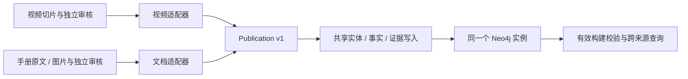

# 视频与 DJI / Parrot 文档统一知识图谱

两条管线保留各自的解析、抽取和审核流程，通过适配器交付共享发布协议，并在原有发布事务内写入同一 Neo4j 实例的 `KG*` 投影。共同的实体、事实、证据和有效版本由 `backend/app/services/knowledge_graph/` 管理。

## 职责与模型



| 模块 | 职责 |
|---|---|
| `schema.py` | `Publication / Entity / Fact / Evidence` 协议、结构校验、稳定身份与指纹 |
| `adapters.py` | 从已审核的视频、文档输出生成统一发布对象，重新核对原文及审核绑定 |
| `storage.py` | 约束、实体复用、事实去重、证据关联、有效版本切换与可见性 |
| `queries.py` | 独立回读校验、来源过滤、实体查询、分页与跨来源证据聚合 |

| 节点 | 含义 |
|---|---|
| `KGSource` | 来源身份：`source_type:external_id`；保存标题、URL、元数据和有效构建指针 |
| `KGBuild` | 不可变发布版本；绑定原生构建 ID、完整发布内容、schema 和 adapter 版本 |
| `KGEntity` | 共享实体，保留规范名、实体类型和身份作用域 |
| `KGFact` | 关系、属性、状态或操作；保留断言、条件和结构化细节 |
| `KGEvidence` | 某来源构建对事实的证据；包含原文、定位、审核指纹及可选置信度 |
| `KGMention` | 某来源中实体的具体提及及其身份依据 |

事实 ID 由主体、关系、客体或属性值、类别、断言、条件和结构化细节决定，证据独立保存。相同事实可共享节点并关联不同证据；否定、存疑、不同参数值或不同条件会形成不同事实。视频中已审核的实体属性转换为属性事实，证据引用原始切片全文；摘要证据的置信度上限保持为 0.5。LED 模式与操作状态保留在事实 `details` 中。

文档定位保留 PDF 哈希、版本、物理页码、文本行、图片区域、裁剪坐标和图片哈希；视频定位保留切片 ID、原文字符偏移、起止秒数和字幕来源。视觉证据允许没有文字引用，定位数据不可为空。

实体沿用已审核身份 ID。相同全局规范身份共享节点；大小写差异按规范化名称比较。局部视频身份、机型限定部件和全局身份保留各自作用域，不按名称相似度强行合并。本批次可同时看到一个全局 `DJI Air 2S` 和一个视频局部的同名实体，跨来源复用的是已确认的全局身份。未来若要提升这类召回，需增加有证据的身份提升或别名映射，并单独评测。

统一实例同时保留原生 `VG* / DG*` 投影，供既有 API、任务和审核校验使用；跨来源 API 读取 `KG*`。原生与共享投影、两边有效指针在同一 Neo4j 事务提交，任一适配或写入失败都会一起回滚。新任务未发布时继续使用旧有效版本。

## 配置与实例

私有文件 `.env.unified-graph`：

```dotenv
UNIFIED_GRAPH_ENABLED=true
UNIFIED_GRAPH_NEO4J_URI=bolt://localhost:7690
UNIFIED_GRAPH_NEO4J_USER=neo4j
UNIFIED_GRAPH_NEO4J_PASSWORD=<独立密码>
UNIFIED_GRAPH_NEO4J_DATABASE=neo4j
```

启用后，视频和文档存储均只连接 `UNIFIED_GRAPH_NEO4J_*`，缺少 URI 或密码直接报错。未启用时，保持原来的视频 / 文档独立连接方式。视频 CLI 的显式连接文件支持完整的旧连接或完整的统一连接，拒绝混合、缺项或关闭开关的统一配置。

```bash
docker compose --env-file .env.unified-graph -f docker-compose.unified-graph.yml up -d
uv run python tools/knowledge-graph/manage_graph.py --env-file .env.unified-graph init
```

当前实例为 `intelligence-rag-neo4j-unified`，Browser 为 <http://127.0.0.1:7477>，Bolt 为 `bolt://localhost:7690`。独立项目 `rag-unified-graph` 使用独立的 `unified-graph-data / unified-graph-logs` 卷。旧视频、文档实例保留；已有后台任务未改向，后续采用统一配置启动的两条管线写入新实例。

## 两条管线的入口

文档继续使用原 CLI，替换配置文件即可：

```bash
uv run python tools/document-knowledge-graph/build_graph.py --env-file .env.unified-graph pipeline \
  --source-bundle data/document_graph_runs/isolated-20261111/source \
  --report data/knowledge_graph_runs/unified-20261111/document-final.json \
  --response-cache data/document_graph_runs/isolated-20261111/responses --cache-only
```

视频正常构建继续使用原 CLI：

```bash
uv run python tools/video-knowledge-graph/build_graph.py pipeline \
  --neo4j-env-file .env.unified-graph \
  --content-id 044303a4-6d9f-48ae-9dec-ba2f23d6446f --limit 1 \
  --manifest data/knowledge_graph_runs/unified-20261111/video-plan.json \
  --report data/knowledge_graph_runs/unified-20261111/video-pipeline.json
```

首次迁移已有审核结果时，可使用只读源图谱、复用原始业务材料的重放入口。工具会检查源图谱与当前 PostgreSQL 切片一致，再通过原来的任务领取、检查点和激活函数入库；不调用模型、不修改来源库。已有同版本视频会重投影共享层并核对原生和共享结果，适配器升级可复用该入口。

```bash
uv run python tools/knowledge-graph/manage_graph.py --env-file .env.unified-graph replay-video \
  --source-env-file .env.video-graph-next \
  --content-id 044303a4-6d9f-48ae-9dec-ba2f23d6446f \
  --report data/knowledge_graph_runs/unified-20261111/video-replay.json
```

文档撤回 / 恢复仍走文档 CLI，并同步共享来源的可见性。视频撤回会清除有效指针；视频恢复后需再次运行重放或构建，遵循原有视频生命周期。来源撤回不删除被其他来源使用的实体或事实。

## API 与验证

```bash
uv run uvicorn app.knowledge_graph_main:app --app-dir backend \
  --env-file .env.unified-graph --host 127.0.0.1 --port 8002
```

- `GET /knowledge-graph/sources`：来源及有效版本。
- `GET /knowledge-graph/verify?source_id=...`：独立校验某个来源的实际投影与发布契约。
- `GET /knowledge-graph/retrieve?q=DJI%20Air%202S`：统一检索；支持 `source_type / source_id / entity_id / predicate / limit / offset`。
- `/document-graph/assets/{source_id}/{asset_id}`：同一实例中的原始手册资源。

检索先校验有效来源的实体、端点、提及和证据，再分页返回事实和各来源证据。发现篡改或查询期间来源变化时拒绝返回。原有视频、文档管线的验证报告也会检查共享投影是否与当前原生审核输出相符。

```bash
uv run python tools/knowledge-graph/verify_graph.py \
  --env-file .env.unified-graph --api-url http://127.0.0.1:8002 \
  --document-source data/document_graph_runs/isolated-20261111/source \
  --output data/knowledge_graph_runs/unified-20261111/unified-review.json
```

工具覆盖全部 HTTP 分页，核对实际图谱事实 ID，下载所有引用图片校验哈希和 ETag，并生成完整实体 / 事实 HTML 复核表。

## 本轮真实数据结果

1 个视频 `DJI Air 2S | First Use Guidelines` 与两本手册的 13 个代表页已入同一实例：

| 来源 | 有效实体 | 去重后事实 | 事实证据 |
|---|---:|---:|---:|
| DJI Air 2S 视频 | 56 | 30 | 31 |
| DJI Air 2S 手册 | 33 | 102 | 103 |
| Parrot ANAFI Ai 手册 | 25 | 75 | 76 |
| 合并后 | 112 | 207 | 210 |

共 77 条实体间关系、130 条属性 / 状态 / 操作事实，15 个引用图片资源。`DJI Air 2S` 和 `DJI Fly` 两个全局实体同时被视频与手册引用。原生手册仍为 179 条事实，共享层对其中两条语义完全一致的重复事实合并节点并保留各自证据，因此共享手册事实为 177 条。

数据与证据：

- [全量实体与事实复核表](../data/knowledge_graph_runs/unified-20261111/unified-review.html)、[机器报告](../data/knowledge_graph_runs/unified-20261111/unified-review.json)。
- [视频原生及共享管线验证](../data/knowledge_graph_runs/unified-20261111/video-pipeline.json)、[文档发布验证](../data/knowledge_graph_runs/unified-20261111/document-final.json)。
- [跨来源查询与撤回恢复审计](../data/knowledge_graph_runs/unified-20261111/lifecycle-audit.json)。全局 Air 2S 实体可查询 69 条相关事实；撤回 DJI 手册后视频仍可检索，手册图片 404，恢复后事实 ID 完全一致且图片恢复 200。
- [重启持久化审计](../data/knowledge_graph_runs/unified-20261111/persistence-audit.json)：节点计数及全部有效版本保持一致，重启后重新验证全部 HTTP 事实和引用图片。
- [实例与卷隔离审计](../data/knowledge_graph_runs/unified-20261111/isolation-audit.json)：四个数据库 ID 不同，统一实例卷与旧实例无交集，旧实例均无 `KGSource` 节点。
- [文档 golden 对照](../data/knowledge_graph_runs/unified-20261111/document-final-comparison.html)：19/19 目标、13/13 图文关联、4/4 负例通过。此指标限于已人工复核目标，不代表全图精确率或 F1。
- 共享层专项测试 18 项通过；相关单元回归 345 项通过、18 项跳过、4 项未选中；原生视频 / 文档 Neo4j 集成回归 29 项通过、1 项跳过。

本轮复用既有真实模型响应和已审核视频结果，新模型 HTTP 调用为 0。视频抽取规则指纹仍为 `dcdff7721e27`。图谱与结构测试使用合成夹具，真实数据验证使用上述实际视频与 PDF，两者分别记录。

## 新来源与协议演进

新来源适配器交付 `Publication`，完成来源特有的抽取与审核后，再调用共享 `publish`。`source_type`、实体类型和关系名均可扩展；`Evidence.locator` 可保存维修步骤 ID、论坛回复 ID 等定位数据。新增来源通常增加适配器和对应验证，公共发布及查询流程可复用。

`schema_version` 与 `adapter_version` 分别记录结构和映射版本。事实含义或结构变化时应递增版本，明确读取兼容与回填策略；当前不承诺自动兼容任意未来大版本。文档策略指纹包含共享层代码，改动后用新报告路径重新校验；视频共享适配升级可通过 `replay-video` 重投影，保持原抽取和审核结果。

当前提供统一图谱与查询 API；聊天问答页面仍使用原有检索配置，未在本轮自动切换。
