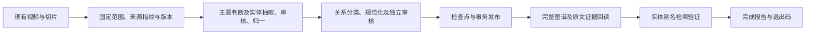

# 视频知识图谱完整构建管线

2026-11-10更新：当前模块已归入 `app/services/video_graph/`，在线图谱仅使用 Neo4j；以下保留原实现/评测记录，当前职责及兼容边界见[模块重构说明](video-graph-refactor-2026-11-10.md)。

2026-11-06更新：增加真实 token 用量统计和任务内的阶段请求检查点，两个后端均支持跨 worker 失败恢复；当前相关回归为461项通过。新增行为及评测见[token 开销优化](video-graph-token-optimization-2026-11-06.md)。以下为首次闭环实现记录。

范围：从已经保存的视频切片开始，到图谱发布、证据回查与检索验证结束。新增统一命令 `build_graph.py pipeline`，复用现有任务、租约、检查点和事务发布，支持PostgreSQL、Neo4j两种图谱后端。

抽取策略仍为 `f39b9656b91a`，模型为 `deepseek-v4.1-flash-economy`，抽取/审核推理均none。本次未修改抽取提示词、golden或评分规则；质量实测见[关系优化报告](relation-direction-and-recall-2026-11-05.md)。



## 一条命令执行

在项目根目录运行。VIDEO_UUID替换为实际视频content_item_id，参数可重复。

```bash
# 只读预览：不写清单、报告或图谱，不调用模型
.venv/bin/python tools/video-knowledge-graph/build_graph.py pipeline \
  --content-id VIDEO_UUID --limit 1 \
  --manifest data/video_graph_runs/video-build.plan.json \
  --report data/video_graph_runs/video-build.report.json \
  --dry-run

# 正式执行：去掉dry-run
.venv/bin/python tools/video-knowledge-graph/build_graph.py pipeline \
  --content-id VIDEO_UUID --limit 1 \
  --manifest data/video_graph_runs/video-build.plan.json \
  --report data/video_graph_runs/video-build.report.json
```

未指定content-id时，优先选择需要升级的有效旧图谱，其次未构建视频，最后已经为当前版本的视频。新清单最多纳入limit条（默认20），清单之外的视频不会被排队。batch-size默认5。旧run命令仍保留“扫描范围全部排队，再最多处理limit条”的语义。

清单固定视频、来源指纹、基线有效版本及目标抽取版本；报告保存构建结果和逐项回读校验。两者路径必须不同。已有清单恢复执行，不静默改变版本或范围；恢复时limit不能小于清单条数。已经为当前版本的视频跳过模型，但仍核验实际数据库。

整个库没有候选视频时selected=0，表示无任务；显式指定的记录不存在或已撤回则报错，不误报为已构建。

## 连接与初始化

构图读取 `SYNC_DATABASE_URL` 中的视频和切片；它与API异步连接 `DATABASE_URL` 是独立配置。切换目标库或使用隔离库时，应同时确认两者，不能只覆盖DATABASE_URL。

- `VIDEO_GRAPH_BACKEND=neo4j`：图谱、任务和检查点在Neo4j，需配置NEO4J_URI、NEO4J_USER、NEO4J_PASSWORD、NEO4J_DATABASE。来源仍从PostgreSQL读取。
- `VIDEO_GRAPH_BACKEND=postgres`：来源与图谱均使用PostgreSQL，需先完成项目迁移。
- 真实抽取使用LLM_API_KEY、BASE_URL、LLM_MODEL等现有配置。dry-run不要求模型密钥；Neo4j模式会只读检查图谱连接及迁移状态。
- pipeline不自动执行PostgreSQL迁移。正常执行复用Neo4j约束初始化；dry-run不创建约束或数据。

切片选择不变：优先transcript_segment；无字幕时使用video_summary且只生成实体。Qdrant索引状态不影响构图。

## 何时算完成

构建任务返回success只是必要条件。每个选定视频还须通过：

| 校验 | 内容 |
|---|---|
| source_current | 当前来源指纹与清单一致 |
| active_current | 有效构建的版本、来源和目标任务一致，状态success，未撤回或删除 |
| saved_output_valid | 存储的主题判断、发布标记、切片范围、覆盖率和审核凭据有效 |
| graph_complete | 全量查询，无数量截断或小型子图隐藏 |
| entities_equal | 实体ID、规范名称、类型与审核输出一致 |
| relations_equal | 关系ID、方向、谓词、全部qualifiers一致 |
| mentions_equal | 实体提及的切片、实体和字符偏移一致 |
| evidence_equal | 证据原文、偏移、断言、时间和字幕来源一致 |
| retrievable | 有边时，实体检索能返回同版本、同视频、同限定条件的原文引用 |
| unchanged_during_verification | 回读后再次确认来源和有效构建未并发变化 |

验证复用图谱API查询服务：所有实体/关系及源记录逐项比较，有边时另做一次实体别名检索探针。合法的摘要实体、无材料或不相关视频不虚构关系。它验证发布一致性与可回源检索，不把任务success当作抽取语义准确率100%。

回读时关闭前端默认的小型子图筛选和数量限制，因此两节点一关系也可验证；前端可能按默认规则隐藏小图，底层数据仍存在。

## 状态与恢复

| 阶段/状态 | 含义 |
|---|---|
| pipeline_plan | 固定范围、数量与目标版本 |
| backfill_result | 单视频构建结果、覆盖率、质量摘要与错误 |
| pipeline_verification | 单视频回读结果及checks |
| pipeline_summary / success | 全部选定视频验证通过，退出0 |
| pipeline_summary / incomplete | 有失败、部分完成、过期、冲突或数据不一致，退出1 |
| failed | 管线执行异常，报告保存error_type，退出1 |

只有最终pipeline_summary的success才算完成，中途某视频的构建成功不能代替整批验证。

模型失败和部分完成须显式重试；仍有效的成功切片会复用：

```bash
.venv/bin/python tools/video-knowledge-graph/build_graph.py pipeline \
  --manifest data/video_graph_runs/video-build.plan.json \
  --report data/video_graph_runs/video-build.report.json \
  --limit 1 --retry-failed
```

来源或抽取策略变化时，使用新的清单和报告路径。已撤回视频先显式restore。实际落库缺失或损坏时报告验证失败，不靠重新调用LLM掩盖存储问题。

沿用原有发布策略：首次部分结果可能可见，但pipeline判为incomplete；已有完整图谱时，新版本部分完成保留旧图谱。失败、来源变化、租约过期和版本冲突不能覆盖有效图谱。恢复仍检查数据库真值，不只相信报告状态。

## 验证结果

相关439项测试通过，其中36项为新管线测试。使用独立PostgreSQL和Neo4j容器，逐测试清理专属来源schema或测试图，未重置业务库。

覆盖有界选择、幂等、检查点恢复、失败重试、部分完成、来源变化、证据缺失、发布元数据损坏、撤回保护、摘要/无材料/不相关视频、CLI退出码，以及实际CLI→HTTP响应回放→发布→查询的两后端链路。精确回放只接受已记录请求，未知请求失败，不生成补位结果。

另对EG003来源副本进行了真实模型调用到隔离Neo4j的完整验证：

| 项目 | 结果 |
|---|---|
| 抽取版本 | video-graph-v2:deepseek-v4.1-flash-economy:f39b9656b91a-none-none |
| 模型阶段 | 5次：主题判断、实体初抽、实体审核、关系分类、关系审核 |
| 实体 / 关系 | 2 / 1 |
| 提及 / 关系证据 | 2 / 1 |
| 覆盖率 | 1/1切片通过 |
| 关系 | DJI Studio → applied_to → DJI Avata 360 |
| 检索证据 | 1条，可回查原文与限定条件 |
| 重复执行 | 仍验证通过，新增模型调用0次 |

真实调用使用现有模型配置；输入从golden对应的已有切片复制到隔离来源库，测试图和schema随后清理，非业务库批量回补。[真实运行报告](../data/video_graph_runs/build-pipeline-live-neo4j-20261105.json)、[模型/图谱/检索核验](../data/video_graph_runs/build-pipeline-live-neo4j-20261105.audit.json)。

实现：[管线编排与验证](../backend/app/services/video_graph_build_pipeline.py)、[CLI](../tools/video-knowledge-graph/build_graph.py)、[有界回补](../backend/app/services/video_graph_backfill.py)、[管线测试](../backend/tests/test_video_graph_build_pipeline.py)。

```bash
# 未指定隔离库时，数据库测试明确skip
.venv/bin/python -m pytest backend/tests/test_video_graph_build_pipeline.py -q
```

显式设置VIDEO_GRAPH_TEST_DATABASE_URL和空NEO4J_TEST_URI/NEO4J_TEST_PASSWORD后，同一文件运行两个真实存储后端测试。Neo4j fixture会拒绝已有VG节点的图；测试地址应为专用实例。
