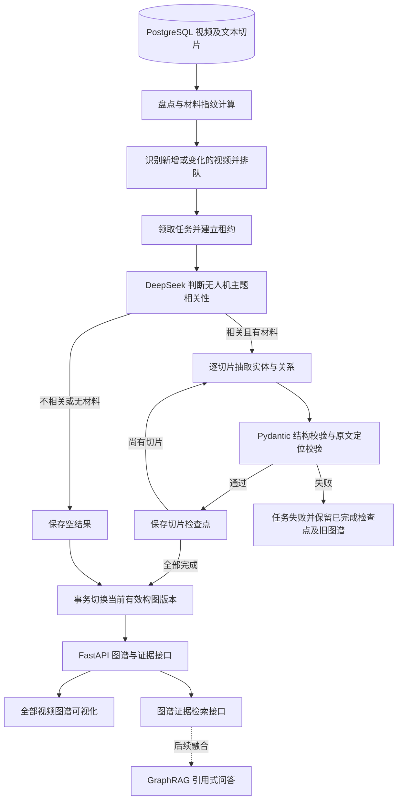

# 视频知识图谱第一版建设进展

整理日期：2026 年 10 月 15 日。

本文依据现有代码、首批构图报告及本轮开发过程中已记录的数据库排查、测试和部署结果整理。不同日期的数据分别列示，不将历史快照当作当前实时统计；本文整理期间未重新运行构图、查询生产数据库或变更部署。

## 一、阶段结论

第一版已打通“视频字幕切片 → 模型抽取 → 原文校验 → 图谱存储 → 增量维护 → 前端可视化”的完整流程，并提供面向后续 GraphRAG 的图谱证据检索接口。

当前已具备可运行、可追溯、支持断点恢复的图谱原型。实际批量运行也暴露出明显的稳定性问题：最近一次已记录的 481 个视频任务中，201 个处理成功、280 个失败。下一阶段应优先降低抽取及校验失败率，再扩大数据覆盖、接入问答生成。现阶段尚不能将其视为已经完成质量验证的 GraphRAG 问答系统。

## 二、建设范围与数据来源

### 1. 本版处理范围

第一版只处理 PostgreSQL 中 `content_items.item_type=video_description` 的视频记录，主要面向无人机产品、组件、软件、技术、维修及故障信息，不处理论坛、供应链和论文数据的统一构图。

构图输入来自 PostgreSQL 已保存的文本切片，不直接从视频文件、关键帧图片或 Qdrant 中的向量数值抽取关系。

| 数据 | 本版用途 |
|---|---|
| `content_items` | 提供视频标识、标题、来源链接、摘要及元数据 |
| `content_chunks` 中的 `transcript_segment` | 主要证据来源，用于抽取实体和关系，并关联字幕时间戳 |
| `content_chunks` 中的 `video_summary` | 无字幕时的降级输入，仅提取实体提及，不生成技术关系 |
| Qdrant 向量索引 | 现有 RAG 的检索基础；本版构图不依赖其索引成功状态 |
| 视频关键帧、视频文件 | 本版不直接参与图谱抽取 |

切片需未被标记为 `obsolete`，且文本非空。没有支持的字幕或摘要切片时，任务可以成功保存空结果；不相关视频同样保存主题判断和空结果。因此，“任务成功”不等于“生成了有效关系”。

### 2. 构建流程



## 三、核心进展：已完成的工作

### 1. 实现视频专用构图脚本

入口为 [`tools/video-knowledge-graph/build_graph.py`](../tools/video-knowledge-graph/build_graph.py)，提供以下命令：

| 命令 | 已实现能力 |
|---|---|
| `inventory` | 只读盘点视频、字幕及摘要切片情况 |
| `scan` | 扫描材料变化并更新任务队列，不调用模型 |
| `run` | 扫描后执行一个有限批次，默认最多处理 20 个视频任务 |
| `watch` | 按轮次持续处理、轮询新增或变化材料 |
| `withdraw` / `restore` | 撤回、恢复某个视频对有效图谱的贡献 |

支持通过 `--content-id` 指定视频，通过 `--retry-failed` 重新排队失败任务，通过 `--extractor-version` 区分抽取规则版本。脚本复用项目现有数据库及模型配置，不自动执行数据库迁移。

### 2. 完成实体、关系与证据抽取

使用 DeepSeek Chat Completions 接口进行视频主题判断及逐切片抽取；已有真实运行报告使用的模型为 `deepseek-flash`，具体模型由 `DEEPSEEK_MODEL` 配置。

请求采用 JSON 输出格式、`temperature=0`，并在请求体中显式设置：

```json
{"thinking": {"type": "disabled"}}
```

实体类型覆盖企业／品牌、产品、组件、软件、协议、技术、方法及故障。关系类型包括 `uses`、`contains`、`compatible_with`、`applied_to`、`reports_fault`、`mitigates`，可保留版本和适用条件等限定信息。

标题、摘要和邻近切片只作为理解上下文；实体的 `surface_text` 和关系的 `quote` 必须能在当前切片原文中定位。关系证据保存原文、字符偏移、视频起止秒数、字幕来源、置信度以及 `asserted`、`uncertain`、`negated` 三种陈述状态。

这种校验保证了证据能够回到字幕中，但不代表模型理解或字幕陈述已经得到独立事实核实。

### 3. 建立图谱存储与版本管理

复用现有实体及实体提及表，并新增五张图谱专用表，迁移文件为 [`0005_video_knowledge_graph.py`](../backend/alembic/versions/0005_video_knowledge_graph.py)。

| 表 | 作用 |
|---|---|
| `entities`、`content_entity_mentions` | 实体、实体在视频切片中的原文提及 |
| `video_graph_aliases` | 按类型维护实体名称和别名 |
| `video_graph_relations` | 保存带方向、类型及限定信息的去重关系 |
| `video_graph_evidence` | 关联构图版本、关系、原文证据及视频时间 |
| `video_graph_builds` | 保存材料指纹、抽取版本、任务状态、租约及切片检查点 |
| `video_graph_states` | 记录每个视频的期望构图版本、当前有效版本及撤回状态 |

本版使用 PostgreSQL 保存和查询图结构，未引入独立图数据库。实体按类型及归一名称生成稳定标识，内置少量明确别名映射，例如企业类型的“大疆”和 DJI；开放式实体消歧尚未完成。

### 4. 实现增量更新与断点恢复

材料指纹覆盖视频标识、标题、链接、摘要、字幕来源与语言、切片 ID、文本及时间戳；材料指纹、视频 ID 和抽取版本共同识别任务，模型名称也纳入任务版本。

- 新增视频或构图输入变化后，生成相应待处理任务；材料和版本未变化的成功任务会跳过。
- 每个切片成功后保存检查点。失败重试复用已完成切片，不必从整条视频开头重新调用模型。
- 所有切片完成后，才在事务中切换该视频的有效图谱；失败时保留上一次成功版本。
- 使用 `FOR UPDATE SKIP LOCKED`、5 分钟租约及租约 token 支持多个 worker 领取任务，并阻止旧 worker 提交过期结果。
- 提交前再次核对材料指纹和期望版本，避免源数据变化后激活过期图谱。
- 撤回视频后，其贡献不再进入当前图谱查询；其他视频对同一关系提供的证据仍然有效。

目前增量机制检测的是数据库中已保存材料的变化，并不会自动刷新远端视频字幕。上游字幕变化后，还需要采集端更新数据库及构图输入切片。

### 5. 完成前端可视化及部署迭代

前端新增“工作空间 → 视频知识图谱”，使用 React、TypeScript 和 SVG 展示全部视频范围内的局部图谱，支持实体搜索、实体类型与陈述状态筛选、节点聚焦、1～2 跳展开、关系证据分页、视频时间链接及内容详情跳转。

页面已移除左侧视频查找和“按视频浏览”栏，图谱区域使用完整内容宽度。前端不再通过视频列表限制图谱范围；后端仍保留按视频查询的接口能力。

展示策略也已修正：先按证据数量优先选择关系，在节点额度内成对加入两端实体，再用剩余额度展示无关系实体。这样可以避免新增的孤立实体因名称排序靠前而挤掉原有连线。默认显示上限仍为 80 个节点和 160 条连接，不是全量图谱绘制。

前一轮已验证部署的镜像为 `rag-video-graph-ui:20261014-all-videos`；该标签是部署历史记录，实际运行镜像以运行环境为准。生产前端采用同源 API 地址，由应用同时提供页面和接口。

### 6. 为 GraphRAG 提供检索基础

已提供图谱总览、实体查询、局部图谱、关系证据、单视频任务状态等接口，以及 `POST /video-graph/retrieve`。

当前图谱检索流程是：问题中匹配已知实体名称／别名 → 一跳关系扩展 → 获取有效字幕证据 → 去重并按预算组装带编号、来源链接和陈述状态的上下文。

该接口已经具备为问答提供结构化证据的能力，但尚未自动融合到现有 `/answer`。向量实体链接、图谱与向量混合排序、答案生成以及社区摘要均属于后续工作。

## 四、使用的主要工具与组件

| 工具或组件 | 本次用途 |
|---|---|
| Python、SQLAlchemy、PostgreSQL | 视频材料读取、增量扫描、任务协调和图谱持久化 |
| Alembic | 图谱表的数据库迁移 |
| DeepSeek、HTTPX | 主题判断、实体与关系抽取及模型 HTTP 请求 |
| Pydantic、原文定位校验 | 约束模型输出结构，验证实体提及和证据位置 |
| FastAPI | 图谱浏览、证据查询及检索上下文接口 |
| React、TypeScript、SVG、Vite | 前端交互、图谱渲染和生产构建 |
| Docker、Docker Compose | 构建应用镜像及部署更新 |
| pytest／unittest、Vitest、Playwright | 后端回归、前端组件测试和真实浏览器验证 |

## 五、初步结果与统计口径

### 1. 首批 20 个视频验证：2026 年 10 月 13 日

已保存的运行报告位于本地 `data/video_graph_runs/20261013_1601_batch20.json`。该批次结果如下：

| 指标 | 当时记录的结果 |
|---|---:|
| 处理的视频任务 | 20 |
| 任务成功 | 12 |
| 其中产出图谱的视频 | 10 |
| 其中主题不相关的视频 | 2 |
| 任务失败 | 8 |
| 实体 | 301 |
| 实体提及 | 405 |
| 去重关系 | 147 |
| 关系证据 | 148 |
| 已完成切片检查点，含失败任务内已完成部分 | 96 |

148 条关系证据中，140 条为陈述、4 条为推测、4 条为否定。上述数字属于首批报告快照，不等同于后续数据库的实时有效数量。

首轮请求曾出现默认 20 秒超时，后续运行临时将 `AGENT_TIMEOUT_SECONDS` 提高到 120 秒，并在限定的同一批视频内继续处理。提高超时有助于较慢响应，但不能解决 DNS、连接建立或模型校验问题。

### 2. 图谱展示优化验证：2026 年 10 月 14 日

当时数据库有 354 条有效关系、364 条关系证据，初始批次的 147 条关系仍全部有效。页面此前默认先按名称填满 80 个实体，只能显示 3 条关系；该批实体涉及的其他 68 条关系因缺少另一端节点而无法加入画面。

改成关系优先、成对加入实体后，在相同数据和 80 个节点上限下，默认画面显示 55 条关系。此过程只改变子图选取方式，没有删除或重建业务图谱数据。

此阶段后端 23 项测试通过，包括独立临时 PostgreSQL schema 中的集成测试；前端 4 项图谱组件测试及生产构建通过。真实浏览器验证了图谱连线、实体搜索、证据展示和移除视频侧栏后的完整宽度布局。以上是已记录的验证结果，本文整理时未重新执行这些测试。

### 3. 扩大处理后的排查快照：2026 年 10 月 15 日

最近一次已记录的任务统计为：

| 指标 | 数量 |
|---|---:|
| 扫描视频 | 481 |
| 任务成功 | 201 |
| 其中主题判断为相关 | 157 |
| 其中不相关或无支持材料 | 44 |
| 任务失败 | 280 |
| 待处理／运行中 | 0 |

任务完成成功率约为 41.8%。157 个主题相关任务不等于 157 个视频都有关系；其中仍可能存在仅有实体提及或未抽出关系的结果。该时点未记录完整实体、关系及证据总量，不能用上一时点的 354 条关系代表这一快照。

280 个失败任务的外层异常分类为：`ValueError` 248 个、`RuntimeError` 17 个、`ValidationError` 15 个。原始日志没有逐条保存具体校验原因和底层异常，不能将全部同类错误直接归因于同一个问题。

### 4. 统计解释

后续报告和前端需要区分以下指标：

- **扫描视频数**：数据库中符合本版范围的视频数量。
- **任务成功数**：包括有图谱、主题不相关、无材料等成功结果。
- **有效图谱覆盖视频数**：当前有效版本中实际含实体或关系的视频数，建议分别统计。
- **有效关系数**：当前有效版本证据支持的去重关系总量；相同关系由多个视频支持时，关系数不一定增加，但证据数可以增加。
- **页面展示关系数**：受实体搜索、类型、状态、聚焦范围及节点和连接上限影响的子图数量。

例如 `queued: 0, unchanged: 481` 表示本轮扫描未发现需要排队的任务；`unchanged` 同时可能包含成功和未显式重试的失败任务，不代表全部成功。

## 六、需要完善和改进的地方

### 1. 模型输出与原文校验的失败率偏高

抽样复现发现，模型会把字幕里的简称扩写成完整型号，例如原文为 `Pro Cine`，返回 `Mavic 3 Pro Cine`；也会补充品牌或改变名称写法。虽然语义可能接近，但返回值并非当前切片中的连续原文，因而被拒绝。

目前定位只容忍空白差异，大小写、标点、名称补全和跨片段拼接都可能导致定位失败。应让模型明确区分“原文提及”和“标准名称”，增加原文复制示例及有限次数的校验反馈纠错，并始终保留可回溯的原文字段和偏移。不能通过直接关闭证据校验来提升表面成功率。

另有模型返回额外 `type` 字段的复现案例，触发严格结构模型的 `extra_forbidden`。需要加强输出结构约束，并对结构错误实施有上限的纠错重试。

### 2. 网络稳定性和重试机制不足

实际诊断出现过 `ConnectError`、DNS 解析失败，也有正常 HTTP 200 响应，说明至少存在间歇性网络故障。历史 `RuntimeError` 还可能包装 HTTP 错误或 JSON 解析失败，现有记录无法逐一还原。

需要检查容器 DNS 和出口网络，对连接错误、读取超时、限流及部分服务端错误增加有限重试与退避；配置错误、权限错误和确定性的校验错误应分开处理，避免无效重复请求。

### 3. 错误信息和运行可观测性不足

当前失败输出主要保留外层异常类型，无法直接看到失败阶段、底层网络异常、HTTP 状态、字段位置或具体原文定位问题。

建议增加脱敏的结构化错误分类和阶段信息，同时记录视频 ID、切片 ID、已完成进度、尝试次数、请求耗时及模型用量。既要支持定位问题，也要避免记录密钥或不必要的完整模型响应。

### 4. 视频级完成策略影响批量成功率

本版选择全部切片成功后才激活新图谱，避免把不完整结果当作完整版本。但长视频中任一切片失败，整条任务都会标为失败，即使大部分切片已经完成。

需要先完善切片级纠错、失败定位及定点重试，并单独展示“已完成切片比例”。如后续引入部分结果预览，应明确标记完整性，并与正式有效图谱区分。

### 5. 持续运行和增量扫描仍需优化

`watch` 会持续轮询，但失败任务默认不自动重试；即使使用 `--retry-failed`，也仅在启动后的首次扫描生效。队列耗尽后，重复输出扫描信息是空闲等待，而非卡死。

后续需要提供更明确的空闲提示、成功／失败／待处理汇总，并设计按错误类型和重试预算控制的恢复策略。规模继续增加后，应评估按变更时间或事件增量扫描，减少重复读取所有视频及切片的成本。

### 6. 实体消歧和抽取质量尚未系统评估

目前只做稳定标识及少量别名归一，仍可能存在中英文名称、简称、型号变体、品牌与产品混淆，以及重复或过于泛化的实体。

需要建立分层人工评审样本，覆盖产品介绍、维修、故障、安全技术、长视频及摘要降级场景，分别评价主题判断、实体边界、关系方向、类型、证据匹配与陈述状态。当前关系置信度不能直接当成事实准确率。

### 7. 前端表达和 GraphRAG 集成仍有缺口

前端仍需清晰区分处理成功数、真正有图谱的视频数、全局关系总量和当前展示范围；较大图谱的布局、渐进展开及高连接实体导航也可进一步改进。

GraphRAG 目前停留在图谱上下文检索阶段，尚缺少与现有关键词／向量检索的融合、答案生成、统一引用及效果评估。

## 七、下一步规划

下表是建议实施顺序，尚未全部实现，不作为已完成成果或交付时间承诺。

| 优先级与阶段 | 计划工作 | 验收依据 |
|---|---|---|
| P0：可诊断性 | 增加失败阶段、错误分类、切片进度和脱敏底层异常；补齐状态统计 | 新失败任务可以直接区分网络、HTTP、解析、结构和原文校验问题 |
| P0：小批次恢复 | 修复 DNS／网络问题；增加有限网络重试和模型校验反馈纠错 | 在固定失败样本上比较修复前后结果、请求次数和成本，不靠放宽证据约束通过 |
| P1：质量基线 | 按场景抽样人工评审，明确原文提及与标准名称的分工，完善别名策略 | 形成可复查样本及主题判断、实体和关系质量报告 |
| P1：有序回补 | 按错误类型和视频长度分批恢复失败任务，复用切片检查点 | 单独记录新增成功、仍失败、空结果及实际关系覆盖，避免重复处理无变化成功任务 |
| P1：增量运维 | 优化空闲日志、重试预算和增量扫描；补齐上游材料更新策略 | 验证新增、变化、撤回、恢复和失败保留旧图谱的完整流程 |
| P2：GraphRAG 闭环 | 将 `/video-graph/retrieve` 接入问答编排，与关键词、Qdrant 检索融合 | 回答可引用图谱证据并定位字幕；无实体匹配时可回退现有检索 |
| P2：效果评估 | 对比原有 RAG、图谱检索和混合检索；评估多跳问题及引用质量 | 使用同一评测集比较正确性、证据相关性、引用可追溯性、延迟和成本 |
| P3：范围扩展 | 根据评估结果考虑跨来源构图、视觉证据和更复杂消歧／社区摘要 | 在视频流程稳定且质量可衡量后，按明确场景扩展 |

建议下一轮先固定一组网络失败、原文校验失败和结构失败样本进行修复验证，再分批回补 280 个失败任务。全量无差别重试可能重复消耗模型调用，且无法解决确定性的输出问题。

## 八、运行与查阅入口

以下命令是使用示例，本文整理时未执行。`--limit` 限制每轮尝试的视频任务数，不保证新增同等数量的成功图谱，也不限制单视频的模型请求次数。

```bash
# 继续处理最多 40 个待处理任务；材料和版本未变化的成功任务会跳过
docker exec -e AGENT_TIMEOUT_SECONDS=120 intelligence-rag-app \
  python tools/video-knowledge-graph/build_graph.py run --limit 40

# 显式重新排队失败任务，并最多处理 40 个队列任务
docker exec -e AGENT_TIMEOUT_SECONDS=120 intelligence-rag-app \
  python tools/video-knowledge-graph/build_graph.py run --retry-failed --limit 40

# 持续处理，每轮结束后等待 120 秒；不会持续自动重试失败任务
docker exec -e AGENT_TIMEOUT_SECONDS=120 intelligence-rag-app \
  python tools/video-knowledge-graph/build_graph.py watch --limit 40 --interval 120
```

`--retry-failed` 作用于扫描范围内的所有失败任务，不保证当前批次只处理某次运行的失败视频；定点恢复时可重复传入 `--content-id`。抽取规则变化后应显式规划版本变更及回补范围，避免意外重新处理全部视频。

主要实现和使用说明：

- [视频图谱脚本与运行说明](../tools/video-knowledge-graph/README.md)
- [材料读取、抽取校验及增量构图服务](../backend/app/services/video_graph.py)
- [图谱查询及 GraphRAG 上下文检索](../backend/app/services/video_graph_queries.py)
- [图谱数据模型](../backend/app/models/video_graph.py)
- [图谱 API](../backend/app/api/video_graph.py)
- [前端图谱页面](../frontend/src/pages/VideoGraphPage.tsx)
- [后端回归测试](../backend/tests/test_video_graph.py)
- [前端图谱测试](../frontend/tests/video-graph-page.test.tsx)

本地运行产物位于 `data/video_graph_runs/`，包含首批 JSON 报告及前端验证截图。这些运行产物不保证随版本库分发；正式验收时宜将统计快照、样本评审和测试报告单独归档。
