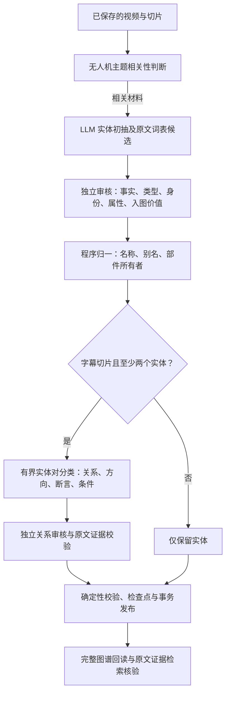
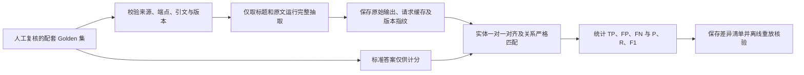

# 本周工作进展：图谱实体／关系抽取与 Golden 集评测

周期：2026 年 11 月 2 日—11 月 6 日。以当前敲定方案及 11 月 5 日评测记录为准。

本周完成了实体与关系的分阶段抽取、原文证据校验、Golden 集严格计分，以及从视频切片到图谱发布和证据检索的统一构建管线。最终方案的实体及类型 F1 为 **88.6%／86.4%**，关系加断言 F1 为 **75.7%／72.5%**，分别对应下文 A、B 两组结果。

## 1. 最终抽取流程

采用 **LLM 提出候选、独立模型调用审核、程序执行确定性校验** 的方式。独立审核指另一次模型调用，仍使用相同模型。

| 配置 | 最终方案 |
| --- | --- |
| 抽取策略指纹 | `f39b9656b91a`，已与当前源码核对 |
| 模型与参数 | `deepseek-v4.1-flash-economy`；温度 0；抽取／审核推理均为 `none` |
| 输入与来源 | PostgreSQL 中已保存的视频字幕切片；标题、摘要、邻文仅辅助消歧，关系必须有当前字幕依据 |
| 输出与存储 | 实体、属性、关系、断言、条件、原文位置及审核凭据；支持 Neo4j／PostgreSQL 图谱后端 |

| 环节 | 方法与实现功能 |
| --- | --- |
| 实体初抽与审核 | LLM 提出实体及属性，领域词表只提供正文实际出现的术语；另一次调用审核原文、类型、身份和检索价值。数值、尺寸等保存为属性，不单独建实体 |
| 实体归一 | 用确定性规则分离名称与参数、合并同一对象的别名，区分不同设备的同名部件；无法确定所有者时不强行绑定 |
| 关系分类 | 根据类型兼容性、原文距离和主要设备生成候选对，每段最多 96 对、每批 16 对；附带角色问题，要求明确回答有关系或无关系，不允许增加实体端点 |
| 关系审核 | 候选关系每批 8 条独立核对，保留肯定／不确定／否定及条件、能力、操作指令等限定；每段最多 80 条关系 |
| 表达与证据校验 | 分类后及审核后统一谓词和方向；如外部软件应用于设备用 `软件 → applied_to → 设备`，设备内置软件用 `设备 → uses → 软件`。引文抄写错误时可返回连续原文行号，由程序取回原文；最多一次格式修正，仍无效则隔离 |
| 发布与回读 | `build_graph.py pipeline` 固定视频范围、来源指纹和抽取版本，复用租约及检查点；发布后逐项核对实体、关系、提及、证据和检索结果，有效旧图谱不被失败的新任务覆盖 |

无字幕时，摘要只抽实体；不相关材料保存主题判断与空结果。整个流程不根据共现、常识或规范名称自动补造关系。

## 2. Golden 集与评测流程

| 项目 | 当前口径 |
| --- | --- |
| 数据集 | 配套的 `entity_gold_v3.json` 与 `relation_gold_v3.json`，均为 `human_reviewed` |
| 样本规模 | 同一批 20 段原文，中文、英文各 10 段；101 条实体、77 条关系，涵盖 13 类谓词 |
| 关系断言 | 70 条肯定、7 条不确定；当前没有明确否定关系标准样本 |
| 模型输入 | 仅标题、当前字幕及从正文匹配的词表候选；标准实体、关系、型号说明 `models` 和复核备注 `notes` 不传入模型 |
| 执行方式 | 运行完整抽取流程，再从同批原始输出分别计算实体、关系指标；不预先提供正确实体，不写生产图谱 |

评分采用确定性匹配，不使用 LLM 自评、自由翻译或模糊子串补分。同一规范身份去重，同一预测最多命中一条标准答案；失败片段的标准答案仍计入漏抽。

| 指标 | 命中要求 |
| --- | --- |
| 实体识别 | 规范名称或人工标注的原文叫法一对一匹配，允许大小写、空白和排版字符归一 |
| 实体及类型 | 实体识别成立，并且类型相同；明确冲突的型号所有者不能匹配 |
| 关系三元组 | 两端实体身份、类型、谓词及方向一致；`compatible_with`、`connected_to` 允许对称方向 |
| 关系加断言（主指标） | 三元组成立，并且 `asserted`／`uncertain`／`negated` 一致 |
| 关系加断言及限定（严格） | 主指标成立，并且全部 `qualifiers` 严格匹配，检查条件、模式和范围是否丢失 |

评测统计指标说明如下，示例使用 A 组的“关系加断言”结果：

| 指标 | 中文含义 | 计算与解释 | 本报告示例 |
| --- | --- | --- | --- |
| TP（True Positive） | 正确抽取数 | 预测与 Golden 答案满足上表对应的匹配要求 | 正确匹配 56 条关系 |
| FP（False Positive） | 多抽／未匹配预测数 | 计分范围内，未匹配 Golden 答案的预测；包括谓词、方向或断言等不符合要求的关系 | 15 条预测未匹配 |
| FN（False Negative） | 漏抽数 | Golden 中未被预测正确匹配的答案，包括因端点实体漏抽而未命中的关系 | 77 条标准关系中有 21 条未命中 |
| P（Precision） | 精确率 | `TP / (TP + FP)`：抽出来并参与计分的结果中，有多少正确 | `56 / (56 + 15) = 78.9%` |
| R（Recall） | 召回率 | `TP / (TP + FN)`：应该抽出的标准答案中，找回了多少 | `56 / (56 + 21) = 72.7%` |
| F1 | 精确率与召回率的调和平均 | `2PR / (P + R)`，等价于 `2TP / (2TP + FP + FN)`；同时衡量少抽错和少漏抽 | `112 / (112 + 15 + 21) = 75.7%` |
| 微平均（Micro） | 汇总计分方式 | 先汇总全部片段的 TP、FP、FN，再计算 P、R、F1，不是逐片段分数的简单平均 | 汇总 20 个片段计分 |

同一条关系若谓词、方向或断言抽错，通常同时产生一个 FP（错误预测）和一个 FN（正确答案未命中）。范围外预测单列待审，不计入 TP／FP。严格限定分数反映记录匹配，措辞或摘录边界差异也可能扣分。

## 3. 最终评测结果

A、B 两组均完成 **20/20** 个片段，失败与待运行均为 0，使用相同 Golden 集、模型配置和评分规则。

| 指标 | A组 TP／FP／FN | A组 P／R／F1 | B组 TP／FP／FN | B组 P／R／F1 |
| --- | --- | --- | --- | --- |
| 实体识别 | 91／9／10 | 91.0%／90.1%／90.5% | 88／10／13 | 89.8%／87.1%／88.4% |
| **实体及类型** | **89／11／12** | **89.0%／88.1%／88.6%** | **86／12／15** | **87.8%／85.1%／86.4%** |
| 关系三元组 | 58／13／19 | 81.7%／75.3%／78.4% | 52／9／25 | 85.2%／67.5%／75.4% |
| **关系加断言** | **56／15／21** | **78.9%／72.7%／75.7%** | **50／11／27** | **82.0%／64.9%／72.5%** |
| 关系加断言及限定（严格） | 45／26／32 | 63.4%／58.4%／60.8% | 41／20／36 | 67.2%／53.2%／59.4% |

受控 A 组与相同实体前序输出的基线比较，关系加断言 F1 从 **65.7% 提升至 75.7%（+10.0 个百分点）**，实体及类型 F1 保持 88.6%。

| 核验项 | 结果 |
| --- | --- |
| 关系计分范围 | A组预测 73 条，其中 71 条范围内、2 条范围外；B组 63 条，其中 61 条范围内、2 条范围外 |
| 两组调用来源 | A组复用基线实体输出及前序精确请求缓存，最终执行重放 97 次、新调用 1 次；B组前序来自另一套全新缓存完整运行，最终执行精确重放 94 次。两组不是最终版全流程的两轮全新调用 |
| 逻辑阶段量 | A组 98 次、B组 94 次，平均每段 4.90／4.70 次，不含视频主题判断；未统计 Token 账单或性能基准 |
| 可复现性 | A组 20 段、98 次阶段请求完整离线重放，0次模型调用，原始输出和指标逐项一致；Golden 集与评分器保护文件未变 |
| 构图闭环 | 已有记录为相关 439 项测试通过；另以真实模型调用到隔离 Neo4j，验证 2 个实体、1 条关系及原文证据回查，重复执行新增模型调用为 0 |

**结果边界：**关系只对 Golden 实体范围内的预测计分，两组各 2 条范围外关系单列待审，因此 Precision 不是全图准确率。这 20 段已用于开发，尚非独立盲测，也未覆盖否定关系；包装随附、安装关系及条件范围仍有漏抽或差异。本周完成代码、开发集评测与隔离库构图验证，尚未批量重建生产图谱。

## 4. 查阅入口

- [最终抽取方案与双组结果](relation-direction-and-recall-2026-11-05.md) · [完整构建管线](video-graph-build-pipeline-2026-11-05.md)
- [实体评测口径](entity-gold-evaluation.md) · [关系评测口径](relation-gold-evaluation.md)
- [A组关系原始结果](../data/video_graph_runs/relation-direction-r3-20261105.json) · [B组关系原始结果](../data/video_graph_runs/relation-direction-r3-repeat-20261105.json)
- [A组实体指标](../data/video_graph_runs/relation-direction-r3-entity-metrics-20261105.json) · [B组实体指标](../data/video_graph_runs/relation-direction-r3-repeat-entity-metrics-20261105.json)

本周报已核对当前策略指纹及本地结果 JSON，未重新调用模型或复跑业务测试。`data/` 中的运行产物不随 Git 分发。
